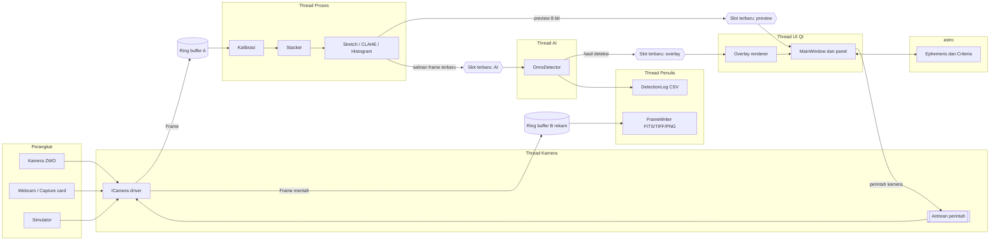
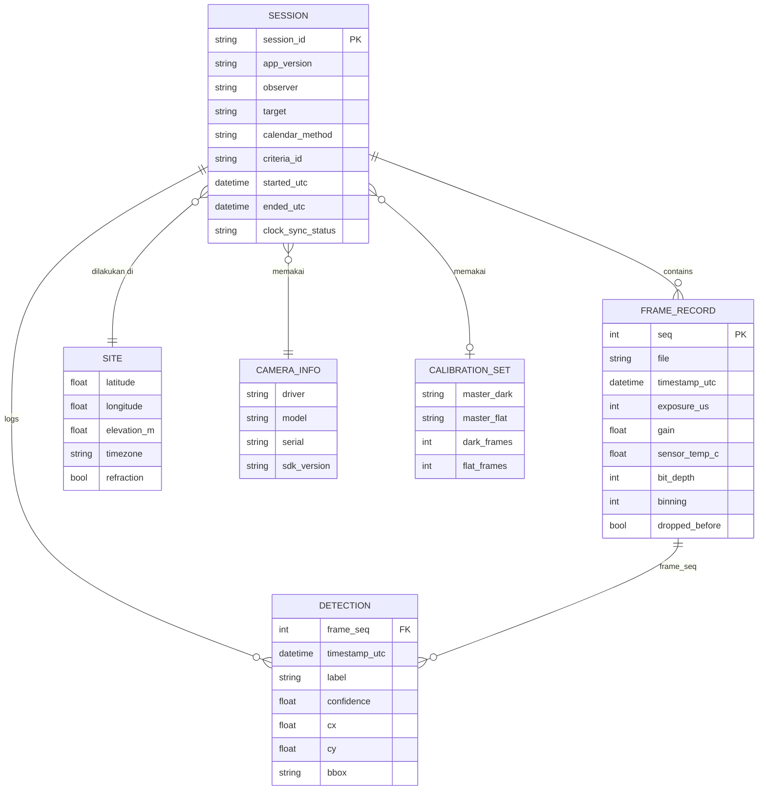
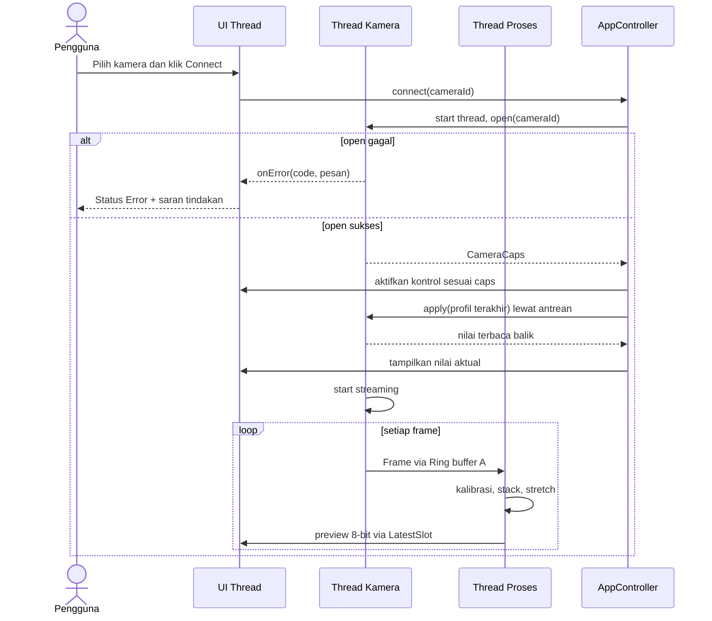
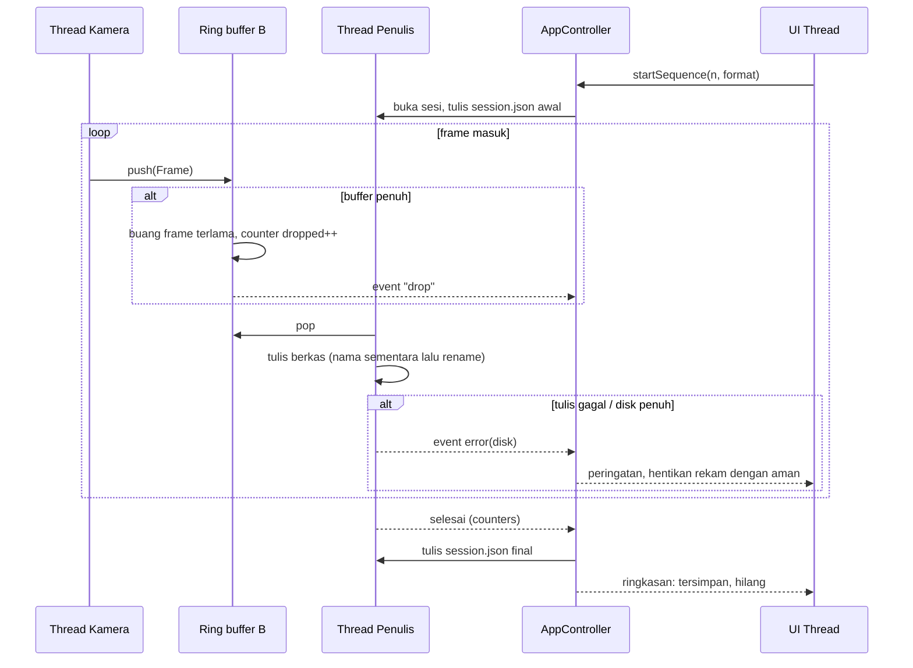

# Technical Specification: Sabit

Versi dokumen: 0.1 (draf) | Tanggal: 23-10-2026
Rujukan: 01-PRD.md (ID FR-xx, NFR-xx, G-xx merujuk ke PRD).
Konvensi: "ASUMSI:" menandai hal yang belum diverifikasi. Detail SDK pihak ketiga tidak dikarang; nama fungsi SDK ditulis sebagai `<SDK_...>` sampai dibaca dari dokumentasi resmi vendor.

---

## 1. Overview & Tujuan Teknis

Sabit adalah aplikasi desktop Windows x64 untuk live view, pemrosesan, dan deteksi hilal. Rebuild ini memindahkan seluruh jalur frame (capture, proses, deteksi, tulis berkas) ke kode native C++ dan menyisakan UI sebagai konsumen frame terbaru.

Tujuan teknis:

1. **Frame jujur.** Data sensor tetap 16-bit (atau float) sampai tahap tampilan; metadata berasal dari hardware (FR-13, FR-15).
2. **Kontrol hardware nyata.** Pengaturan melewati antrean perintah yang dieksekusi di thread kamera, dibaca balik, dan ditampilkan (FR-04).
3. **UI tidak pernah memblokir.** Lima thread dengan tanggung jawab terpisah dan buffer yang membuang frame lama (NFR-01, NFR-02).
4. **Kegagalan terlihat.** Setiap kegagalan koneksi, drop frame, dan kegagalan tulis menjadi event yang tampil di UI dan log (FR-05, FR-18).
5. **Portabel dan offline.** Satu folder, tanpa Python, tanpa hak Administrator, tanpa koneksi jaringan (NFR-08, NFR-09, FR-36).

Perbaikan terhadap cacat Onyx OS dipetakan di bagian 14 (ADR) dan 13 (risiko).

## 2. Arsitektur Sistem

### 2.1 Komponen

| Komponen | Tanggung jawab |
|---|---|
| `camera` | Antarmuka `ICamera`, registry, driver ZWO, UVC, simulator (QHY dan ASCOM di fase 2). Satu thread per kamera aktif. |
| `core` | Tipe `Frame`, `RingBuffer`, `LatestSlot`, `Clock`, `Result`, logging, konfigurasi dasar. |
| `imaging` | Kalibrasi, stacking, stretch, CLAHE, histogram, penulis berkas (FITS/TIFF/PNG). |
| `detect` | Inferensi ONNX, letterbox, non-max suppression, log deteksi. |
| `astro` | Efemeris, sunset/moonset, kriteria visibilitas, kalender Hijriyah, model `Site`. |
| `app` | `AppController`, `Session`, `Settings`, `Profiles`, koordinasi thread, power management. |
| `ui` | Qt Widgets: jendela utama, panel, widget kustom, tema, terjemahan. |

### 2.2 Diagram komponen



Poin desain:

- Dua ring buffer dari kamera: A untuk jalur preview/proses (boleh membuang frame), B untuk rekam (membuang frame hanya bila disk tidak mengejar, dan setiap pembuangan dihitung).
- Slot terbaru (`LatestSlot`) berisi satu item; penulis menimpa, pembaca mengambil yang terbaru. Ini menjamin preview selalu frame terbaru.
- AI membaca salinan frame yang sudah diproses ringan (downscale), tidak pernah menahan thread proses.
- Overlay digambar di UI sebagai layer di atas pixmap preview. Frame rekaman tidak pernah menerima anotasi (FR-22).

## 3. Pemilihan Teknologi

| Komponen | Pilihan | Alasan | Alternatif yang dipertimbangkan |
|---|---|---|---|
| Bahasa inti | C++20 | SDK kamera berupa pustaka native; kontrol memori dan thread; SIMD lewat OpenCV | Rust (aman, tetapi SDK kamera dan Qt bindings menambah gesekan); C# (COM/ASCOM mudah, ekosistem OpenCV/ONNX lebih tipis); Python (GIL, overhead per frame) |
| UI | Qt 6 Widgets (LGPL, link dinamis) | Lanjutan dari PyQt6 yang sudah dipakai; tema QSS dapat dipindahkan | QML (lebih cantik, tetapi biaya belajar dan debug untuk panel padat kontrol); WPF (hanya Windows, GPU path berbeda) |
| Build | CMake + vcpkg (manifest mode) | Reproduksibel, binary cache di CI | Conan; build manual |
| Pencitraan | OpenCV 4.x (vcpkg) | Fungsi stretch, CLAHE, phase correlation, warp sudah matang. ASUMSI: versi 4.x stabil dipakai | Implementasi sendiri (Halide, Eigen) untuk bagian kritis nanti |
| Inferensi | ONNX Runtime (CPU EP default; DirectML EP opsional) | Tanpa torch (ukuran GB), startup cepat, tidak membawa pustaka pelatihan | LibTorch; OpenVINO (bagus di CPU Intel, tetapi mengunci vendor) |
| FITS | CFITSIO | Pustaka referensi FITS | Tulis FITS sendiri (risiko metadata salah) |
| Efemeris | Astronomy Engine (kandidat). ASUMSI: lisensi MIT dan akurasi sekitar 1 menit busur; diverifikasi di M2 | Sumber C ringan, tanpa data eksternal besar | libnova, SOFA/ERFA (lebih berat), porting PyEphem (lisensi dan basis kode lama) |
| Kalender Hijriyah | Tabel kalender di `astro` (metode dipilih pengguna) | Metode harus eksplisit | `hijri_converter` (Python, Umm al-Qura saja) |
| Konfigurasi | JSON dengan skema versi (nlohmann/json) | Terbaca manusia, mudah dimigrasi | TOML, INI, QSettings |
| Log | spdlog (berkas bergulir) | Cepat, thread-safe | Qt logging |
| Uji | Catch2 v3 + pytest untuk alat Python di `tools/` | Ringan, integrasi CTest | GoogleTest |
| Alat bantu (di luar aplikasi) | Python 3 untuk `tools/` (ekspor model, konversi pengaturan, tabel referensi) | Hanya untuk pengembang, tidak dikirim ke pengguna | Skrip PowerShell |
| Pengemasan | `windeployqt` + ZIP portabel; Inno Setup opsional | Berjalan tanpa instalasi dan tanpa Administrator | MSIX (butuh penandatanganan dan kebijakan toko), installer MSI |

## 4. Desain Data

Sabit tidak memakai basis data. Data disimpan sebagai berkas di folder sesi (ADR-07).

### 4.1 Model data (ERD)



### 4.2 Struktur folder sesi

```
Captures/
└─ 2027-02-07_Jakarta_hilal/            # session_id: tanggal_lokasi_target
   ├─ session.json                      # manifest (ditulis berkala, lihat 4.3)
   ├─ session.log                       # log sesi
   ├─ detections.csv                    # log deteksi
   ├─ frames/
   │   ├─ f_000001.fits
   │   └─ ...
   └─ calibration/
       ├─ master_dark.fits
       └─ master_flat.fits
```

### 4.3 Skema dan contoh payload

Manifest sesi (`session.json`), ditulis ulang secara atomik (tulis ke berkas sementara, lalu rename) tiap 5 detik dan saat sesi selesai:

```json
{
  "schema": 1,
  "session_id": "2027-02-07_Jakarta_hilal",
  "app_version": "1.0.0",
  "started_utc": "2027-02-07T10:55:12Z",
  "ended_utc": null,
  "observer": "<nama>",
  "site": { "latitude": -6.2088, "longitude": 106.8456, "elevation_m": 10.0,
            "timezone": "Asia/Jakarta", "refraction": true },
  "camera": { "driver": "zwo", "model": "<dibaca dari SDK>", "serial": "<dibaca dari SDK>",
              "sdk_version": "<dibaca dari SDK>" },
  "capture": { "exposure_us": 100000, "gain": 200, "binning": 1, "bit_depth": 16,
               "cooler": { "enabled": false, "target_c": null } },
  "pipeline": { "calibration": { "dark": true, "flat": true },
                "stack": { "method": "sigma_clip", "frames": 8, "k_sigma": 2.0 } },
  "ephemeris": { "criteria": "MABIMS-baru", "calendar": "<metode>" },
  "clock_sync_status": "synced_2027-02-07T09:12:00Z",
  "counters": { "frames_written": 1240, "frames_dropped": 0, "detections": 31 }
}
```

Baris log deteksi (`detections.csv`, UTF-8, header satu kali):

```
timestamp_utc,frame_seq,label,confidence,cx,cy,x1,y1,x2,y2,exposure_us,gain,sensor_temp_c
2027-02-07T11:03:41.215Z,812,hilal,0.713,640,360,610,338,671,383,100000,200,-5.2
```

Pengaturan aplikasi (`settings.json`, versi 2):

```json
{
  "schema": 2,
  "general": { "language": "id", "theme": "night_red", "prevent_sleep": true },
  "site": { "preset": "Jakarta", "latitude": -6.2088, "longitude": 106.8456,
            "elevation_m": 10.0, "timezone": "Asia/Jakarta", "refraction": true },
  "astro": { "criteria": "MABIMS-baru", "calendar": "<metode>" },
  "capture": { "output_dir": "<folder>", "format": "fits",
               "filename_pattern": "{DATE}_{TIME}_{TARGET}_{SEQ}" },
  "performance": { "ring_buffer_mb": 512, "stack_ram_mb": 2048, "ai_max_fps": 3 },
  "ai": { "model": "models/hilal_v1.onnx", "confidence": 0.5, "provider": "cpu" }
}
```

Aturan: nilai default ada di kode; berkas hanya menyimpan nilai yang berbeda atau seluruhnya (ASUMSI: seluruhnya, lebih mudah dibaca). Key yang tidak dikenal dipertahankan saat menyimpan.

### 4.4 Strategi migrasi

- `schema` pada tiap berkas. Saat dimuat, migrasi bertahap `v1 -> v2` dijalankan di memori; berkas lama disalin ke `settings.json.bak-<tanggal>` sebelum menimpa.
- Konversi dari Onyx OS: `tools/convert_onyx_settings.py` (juga dibangun ke menu Impor) memetakan `general.language`, `general.theme`, `location.*`, `astro.criteria`, `astro.atmospheric_refraction`, dan `saving.output_dir`. Key lain (misalnya `usb_limit`, `gpu_acceleration`, `ascom_mount`, `buffer_frames`) dibuang dan dilaporkan karena tidak dipakai kode Onyx OS (FR-31).

## 5. Desain API

Sabit adalah aplikasi lokal tanpa API jaringan, jadi tidak ada autentikasi. Bagian ini mendefinisikan kontrak internal antar modul. Mode otomasi baris perintah (untuk uji dan alat bantu) tercantum di 5.3.

### 5.1 Kontrak `ICamera`

| Method | Request | Response | Error | Thread / Auth |
|---|---|---|---|---|
| `open()` | `CameraId` | `Result<CameraCaps>` | `NotFound`, `Busy`, `DriverMissing`, `Permission` | Thread kamera; n/a |
| `caps()` | - | `CameraCaps` (rentang exposure/gain, mode bin, bit depth, cooler, ROI, warna/mono, Bayer) | - | Aman dari thread mana pun |
| `apply(CameraSettings)` | exposure_us, gain, bin, bit_depth, roi, cooler | `Future<Result<CameraSettings>>` (nilai terbaca balik) | `OutOfRange`, `Unsupported`, `HardwareError` | Dimasukkan ke antrean; dieksekusi di thread kamera |
| `start(FrameSink&)` | sink | `Result<void>` | `AlreadyStarted`, `HardwareError` | Thread kamera |
| `stop()` | - | - | - | Dengan batas waktu, tidak memblokir tanpa akhir |
| `status()` | - | `CameraStatus` (suhu terukur, daya pendingin, fps aktual) | - | Aman dari thread mana pun |
| Event `onError` / `onDisconnected` | - | `CameraEvent{code, message}` | - | Diteruskan ke UI lewat sinyal Qt |

Aturan kontrak: driver tidak boleh melakukan I/O hardware di luar thread kamera; `apply()` tidak boleh diam-diam menyesuaikan nilai tanpa melaporkan nilai yang akhirnya dipakai; `caps()` tidak boleh mengklaim kemampuan yang tidak diuji.

Sketsa deklarasi (bukan implementasi final):

```cpp
namespace sabit::camera {

struct CameraSettings {
    std::optional<int64_t> exposure_us;
    std::optional<double>  gain;
    std::optional<int>     binning;
    std::optional<int>     bit_depth;
    std::optional<Roi>     roi;
    std::optional<Cooler>  cooler;   // {enabled, target_c}
};

class ICamera {
public:
    virtual ~ICamera() = default;
    virtual core::Result<CameraCaps> open(const CameraId&) = 0;
    virtual CameraCaps caps() const = 0;
    virtual std::future<core::Result<CameraSettings>> apply(CameraSettings) = 0;
    virtual core::Result<void> start(core::FrameSink&) = 0;
    virtual void stop() = 0;
    virtual CameraStatus status() const = 0;
};

}  // namespace sabit::camera
```

### 5.2 Tipe `Frame`

```cpp
namespace sabit::core {
struct Frame {
    uint64_t seq;                 // naik monoton per sesi kamera
    int width, height, channels;  // channels: 1 (mono/raw) atau 3
    int bit_depth;                // 8, 12, 14, 16
    BayerPattern bayer;           // None bila mono/UVC
    std::shared_ptr<uint16_t[]> pixels; // 16-bit; 8-bit UVC di-upcast dengan shift
    // metadata dari hardware (bukan dari slider)
    int64_t exposure_us;
    double  gain;
    double  sensor_temp_c;        // NaN bila tidak ada sensor suhu
    int     binning;
    TimePoint timestamp_utc;      // dari Clock::now_utc() saat frame diterima
    ClockSync clock_sync;         // status sinkronisasi saat itu
};
}
```

### 5.3 Antarmuka lain

| Antarmuka | Bentuk | Keterangan |
|---|---|---|
| Event kamera ke UI | Sinyal Qt (`connected`, `error`, `disconnected`, `settingsApplied`) | Dikirim dengan queued connection |
| Hasil deteksi | `DetectionResult{frame_seq, vector<Detection>, latency_ms}` ke `LatestSlot` | Overlay merujuk `frame_seq` agar dapat membuang overlay yang basi (> 500 ms) |
| CLI | `Sabit.exe --simulator --profile <nama> --perf` | `--perf` menulis metrik waktu frame ke berkas; `--simulator` memilih kamera simulator untuk uji otomatis dan demo |
| Kode keluar | 0 normal; 2 gagal inisialisasi UI; 3 gagal memuat pengaturan tak terpulihkan | Dipakai skrip uji |

## 6. Alur Proses Utama

### 6.1 Connect dan live view



### 6.2 Rekam sequence dengan kebijakan drop



### 6.3 Deteksi AI (ringkas)

1. Thread proses menyalin frame yang sudah diproses ringan ke `LatestSlot` AI dengan frekuensi paling banyak `ai_max_fps`.
2. Thread AI mengubah ukuran dengan letterbox (menjaga rasio aspek), menjalankan ONNX, menerapkan NMS, dan memetakan koordinat balik ke resolusi frame.
3. Hasil masuk ke `LatestSlot` overlay dan ke antrean `DetectionLog`.
4. UI menggambar overlay di atas preview. Overlay yang lebih tua dari 500 ms tidak digambar.

## 7. Struktur Folder & Modul

```
sabit/
├─ CMakeLists.txt
├─ CMakePresets.json
├─ vcpkg.json
├─ cmake/                      # modul CMake, versi, tanda tangan
├─ src/
│  ├─ core/                    # Frame, RingBuffer, LatestSlot, Clock, Result, logging
│  ├─ camera/
│  │   ├─ icamera.h
│  │   ├─ registry.cpp         # pendaftaran driver, enumerasi
│  │   ├─ zwo/                 # driver ZWO (SDK native)
│  │   ├─ uvc/                 # driver UVC
│  │   ├─ sim/                 # simulator
│  │   ├─ qhy/                 # F2
│  │   └─ ascom/               # F2
│  ├─ imaging/                 # calibration, stacker, stretch, clahe, histogram
│  │   └─ io/                  # fits_writer, tiff_writer, png_writer
│  ├─ detect/                  # onnx_detector, letterbox, nms, detection_log
│  ├─ astro/                   # ephemeris, criteria, hijri, site
│  ├─ app/                     # app_controller, session, settings, profiles, power
│  └─ ui/
│      ├─ main_window/
│      ├─ panels/              # camera, exposure, stacking, calibration, ai, ephemeris, log
│      ├─ widgets/             # video_view, histogram_view, collapsible_section
│      ├─ theme/               # token JSON + generator QSS
│      └─ i18n/                # .ts / .qm
├─ vendor/                     # SDK vendor (header + catatan lisensi); DLL diambil saat build
├─ models/                     # hilal_v1.onnx + model card
├─ tests/
│  ├─ unit/  ├─ integration/  ├─ golden/  └─ perf/
├─ tools/                      # export_model.py, convert_onyx_settings.py, ephemeris_reference/
├─ docs/
└─ .github/workflows/
```

Aturan ketergantungan: `ui` bergantung ke `app`; `app` ke semua modul domain; modul domain tidak boleh meng-include Qt kecuali `ui`. `core` tidak bergantung ke apa pun di proyek. Aturan ini diperiksa lewat target CMake terpisah per modul.

## 8. Keamanan

Ringkasan; rincian ada di 09b-Security-Plan.md.

- **Autentikasi/otorisasi:** tidak ada akun; aplikasi lokal. Tidak ada port jaringan yang dibuka.
- **Enkripsi:** data sesi disimpan apa adanya (tidak sensitif secara umum); lokasi pengamat dapat disamarkan pada paket diagnostik. Tidak ada rahasia di dalam aplikasi.
- **Validasi input:** berkas FITS/TIFF/PNG yang diimpor untuk kalibrasi diperiksa ukuran, dimensi, dan tipe sebelum dimuat; batas ukuran maksimum (ASUMSI: 512 MB per berkas).
- **Model ONNX:** model hanya dimuat dari folder `models/` dengan hash SHA-256 yang cocok dengan manifest rilis; model lain butuh konfirmasi eksplisit pengguna.
- **DLL:** memuat pustaka hanya dari folder aplikasi dengan `SetDefaultDllDirectories`/`AddDllDirectory`; tidak membundel DLL sistem (Onyx OS membawa `winusb.dll`, `msvcr90.dll`, `msvcp90.dll`, yang tidak boleh ada di Sabit).
- **Rahasia/secret:** tidak ada; kunci tanda tangan hanya ada di CI.

## 9. Performa & Skalabilitas

### 9.1 Anggaran latensi (1280x720, ASUMSI sebagai titik awal, harus diukur)

| Tahap | Anggaran | Catatan |
|---|---|---|
| Transfer kamera dan konversi ke `Frame` | 20 ms | Termasuk antrean USB; diukur pada ZWO uji |
| Kalibrasi (dark/flat) | 5 ms | Operasi float per piksel; SIMD lewat OpenCV |
| Stacking | 10 ms | Alignment pada citra diperkecil, warp pada ukuran penuh |
| Stretch, CLAHE, histogram | 10 ms | Histogram pada citra diperkecil |
| Konversi 8-bit dan antre ke UI | 5 ms | `LatestSlot` |
| Render UI | 16 ms | Satu frame tampilan |
| **Total terhitung** | **66 ms** | Target p95 ≤ 100 ms (NFR-01), sisa 34 ms sebagai margin |

### 9.2 Strategi

- Tidak ada alokasi per frame di jalur panas: kolam buffer (`FramePool`) dengan ukuran tetap.
- Preview tidak antre: `LatestSlot` menimpa. Rekaman memakai antrean sendiri.
- AI dibatasi `ai_max_fps`; saat CPU jenuh, AI berkurang lebih dulu, bukan preview.
- Stacking memakai akumulator float32 dengan penghitung; RAM dihitung dan dibatasi `stack_ram_mb`; bila batas tercapai, frame terlama dibuang dari jendela dan UI memberi tahu.
- Penulisan berkas di thread terpisah dengan satu berkas sementara per frame lalu rename (atomik).
- Bottleneck potensial: bandwidth USB (kamera 16-bit resolusi tinggi), disk sebagai penghalang rekam (1920x1080 16-bit sekitar 4,1 MB per frame; 20 fps sekitar 83 MB/s), CLAHE pada citra penuh, ONNX pada CPU lemah.

## 10. Observability

- **Log:** `session.log` per sesi dan `app.log` bergulir (maks 10 berkas x 5 MB). Level: error, warn, info, debug (debug hanya lewat `--verbose`).
- **Metrik internal (ditampilkan di panel "Status"):** FPS kamera, FPS preview, latensi tahap (p50/p95), isi ring buffer, frame hilang, kecepatan tulis, FPS inferensi.
- **Tracing:** penanda waktu tiap tahap pada `Frame` (diaktifkan dengan `--perf`, ditulis ke CSV).
- **Alerting:** peringatan dalam aplikasi (bukan notifikasi eksternal): disk < 2 GB, drop frame > 0, kamera terputus, jam belum sinkron > 24 jam, AI melambat (< 1 inferensi/detik).
- **Crash:** pembuat minidump lokal (ASUMSI: `MiniDumpWriteDump` lewat handler pengecualian); tidak ada pengiriman otomatis. Paket diagnostik dapat menyertakannya (FR-33).

## 11. Error Handling & Resilience

| Situasi | Perilaku |
|---|---|
| Kamera tidak ditemukan | Status Error dengan penyebab umum (driver belum terpasang, kamera dipakai aplikasi lain) |
| Kamera putus saat streaming | Thread kamera berhenti bersih; event `onDisconnected`; sesi rekam berhenti aman; opsi reconnect otomatis dengan backoff 1, 2, 4, 8 detik (maks 5 percobaan) lalu menerapkan kembali pengaturan terakhir |
| `apply()` di luar rentang | Ditolak dengan pesan rentang yang benar; nilai tidak berubah |
| `apply()` dibulatkan driver | Nilai yang dibaca balik ditampilkan; log mencatat selisih |
| Timeout capture | Dilewati dan dihitung; setelah 3 detik tanpa frame, status "Tidak ada sinyal" |
| Disk penuh / gagal tulis | Rekam berhenti aman, manifest final ditulis, UI menampilkan sebab |
| Beban berlebih | Buang frame preview tertua; hitung dan tampilkan |
| Model ONNX gagal dimuat | AI dinonaktifkan, tombol AI menampilkan sebab; live view tetap berjalan |
| Pengaturan rusak | Muat default, simpan berkas rusak sebagai `.corrupt-<tanggal>`, beri tahu pengguna |
| Idempotency | Perintah `apply()` idempoten (nilai target, bukan delta); `startSequence` menolak jika sesi aktif |
| Timeout | Semua operasi hardware dengan batas waktu (ASUMSI: buka 10 detik, stop 3 detik); tidak ada `wait()` tanpa batas |

## 12. Strategi Testing

Ringkas; rinci di 05-Testing-QA-Checklist.md.

- **Unit:** `RingBuffer`, `LatestSlot`, `Stacker` (sigma-clip dengan outlier sintetis), `Calibration`, `Criteria`, konversi bit depth, parser pengaturan, migrasi Onyx.
- **Golden:** efemeris, sunset/moonset, dan ijtima terhadap tabel referensi independen (disimpan di `tests/golden/`); paritas ONNX terhadap keluaran .pt pada set gambar tetap.
- **Integrasi:** simulator -> pipeline -> penulis FITS -> pembacaan ulang dan pemeriksaan header; kill proses saat rekam.
- **Kontrak driver:** satu suite yang dijalankan terhadap setiap implementasi `ICamera` (simulator wajib; ZWO dan UVC bila perangkat tersedia).
- **UI:** uji Qt dengan platform `offscreen` untuk pembuatan jendela, pergantian tema/bahasa, siklus hidup.
- **Performa:** benchmark `--perf` pada laptop referensi, dijalankan manual per rilis dan otomatis pada simulator di CI.
- **Lapangan:** 3 sesi (20-11-2026, 21-11-2026, 23-11-2026).

## 13. Dependensi & Risiko Teknis

| ID | Risiko | Mitigasi |
|---|---|---|
| TR-01 | Ukuran distribusi (Qt + OpenCV + ONNX Runtime) besar | Build vcpkg dengan fitur minimum, hanya modul Qt yang dipakai; ukur di M1 |
| TR-02 | SDK vendor membatasi redistribusi atau hanya x64 | Verifikasi lisensi sebelum M2; jaga driver sebagai plugin terpisah |
| TR-03 | Operator ONNX tidak didukung CPU EP, atau hasil berbeda | Uji paritas (G-05); batasi opset saat ekspor |
| TR-04 | Akurasi pustaka efemeris kurang | Golden test terhadap referensi independen; fallback ke implementasi lain di balik antarmuka `Ephemeris` |
| TR-05 | Bandwidth USB menyebabkan frame hilang | Pengaturan bandwidth/ROI/binning; panduan kabel dan port |
| TR-06 | Segfault/kebocoran memori (C++) | Sanitizer di CI (ASan/UBSan pada build uji), pola RAII, tidak ada `new` mentah di jalur panas |
| TR-07 | Qt LGPL: kewajiban link dinamis dan pemberitahuan | Link dinamis; sertakan notice dan cara mengganti DLL; verifikasi sesuai lisensi proyek |
| TR-08 | Alat ekspor model masih membutuhkan Python dan torch/ultralytics (hanya di mesin pengembang) | Pin versi di `tools/requirements.txt`; ekspor dilakukan sekali, hasil `.onnx` di-commit beserta hash dan model card |

## 14. Keputusan Arsitektur (ADR)

**ADR-01: C++20 + Qt 6, bukan Python/PyQt6**
- Konteks: prototipe Python memproses semua di thread UI, membawa torch (ukuran GB), dan rentan gagal start jika satu pustaka (zwoasi, ultralytics) tidak ada.
- Keputusan: inti C++20, UI Qt 6 Widgets.
- Konsekuensi: kinerja dan portabilitas lebih baik, SDK kamera dipakai langsung; biaya: pengembangan lebih lambat, perlu disiplin memori dan keahlian C++.

**ADR-02: ONNX Runtime, bukan torch/ultralytics di runtime**
- Konteks: ultralytics berlisensi AGPL-3.0; torch besar dan memperlambat startup.
- Keputusan: ekspor model ke ONNX (alat ekspor di `tools/`), runtime memakai ONNX Runtime.
- Konsekuensi: distribusi ringan dan runtime tidak membawa pustaka pelatihan; risiko paritas model (diuji, G-05). Status lisensi bobot model hasil pelatihan tetap perlu tinjauan hukum.

**ADR-03: Pipeline 16-bit dengan ring buffer drop-oldest dan slot terbaru**
- Konteks: Onyx OS menormalisasi 8-bit per frame dan menjalankan semuanya di thread UI.
- Keputusan: `Frame` 16-bit, dua ring buffer (preview, rekam), `LatestSlot` untuk UI dan AI.
- Konsekuensi: live view selalu terbaru dan rekaman tidak ditahan oleh preview; konsumsi memori meningkat (diatur batasnya); semua drop dihitung.

**ADR-04: Antrean perintah untuk kontrol hardware**
- Konteks: pada Onyx OS, perintah dikirim sebelum objek kamera ada dan dari thread yang salah.
- Keputusan: `apply()` mengantre dan dieksekusi di thread kamera, mengembalikan nilai yang dibaca balik.
- Konsekuensi: aman terhadap COM/SDK yang terikat thread; UI menampilkan nilai aktual; latensi perintah satu siklus kamera.

**ADR-05: Overlay AI sebagai layer terpisah**
- Konteks: Onyx OS menggambar kotak ke frame dan menampilkan frame lama.
- Keputusan: AI menghasilkan daftar deteksi; UI menggambar overlay di atas preview; rekaman dari frame mentah.
- Konsekuensi: preview tetap live; data rekaman bersih; overlay perlu sinkron berdasarkan `frame_seq`.

**ADR-06: Astronomi di balik antarmuka `Ephemeris`; kriteria sebagai data**
- Konteks: Onyx OS menghitung pada waktu "sekarang", Odeh disederhanakan, BRIN identik dengan MABIMS.
- Keputusan: antarmuka `Ephemeris` (implementasi awal Astronomy Engine, dapat diganti), kriteria di berkas data dengan rumus dan sumber rujukan.
- Konsekuensi: dapat diverifikasi dan diganti; perlu golden test dan peninjauan ahli falak.

**ADR-07: Folder sesi + manifest JSON + CSV, tanpa basis data**
- Konteks: lapangan membutuhkan data yang mudah disalin dan dibuka di alat lain.
- Keputusan: berkas biasa, manifest ditulis atomik dan berkala.
- Konsekuensi: sederhana dan tahan crash; kueri lintas sesi terbatas (penjelajah sesi F2 membaca manifest).

**ADR-08: ZIP portabel, tanpa hak Administrator, tanpa pembaruan otomatis**
- Konteks: laptop pinjaman, lokasi tanpa internet, kebutuhan Administrator pada Onyx OS tidak jelas penyebabnya.
- Keputusan: distribusi ZIP portabel bertanda tangan; pengguna memperbarui secara manual.
- Konsekuensi: risiko pengguna memakai versi lama; dimitigasi dengan nomor versi di UI dan catatan rilis.

## 15. Open Questions

1. Lisensi proyek dan konsekuensinya ke Qt (LGPL) dan pustaka lain.
2. Model kamera ZWO uji: resolusi, mono/warna, ada pendingin atau tidak; menentukan anggaran latensi dan ukuran frame.
3. Apakah driver UVC memakai DirectShow (OpenCV) atau Media Foundation untuk dukungan capture card yang lebih luas?
4. Bagaimana zona waktu ditentukan: pilihan manual (rencana MVP) atau otomatis dari koordinat?
5. Operator ONNX apa yang dipakai model YOLO yang ada; apakah hasil ekspor stabil pada CPU EP?
6. Format sampel rekaman Onyx lama yang bisa dipakai sebagai set uji pemutaran ulang.
7. Perlu mode "putar ulang rekaman" sebagai kamera virtual untuk menguji AI tanpa langit? (diusulkan, belum masuk PRD)
