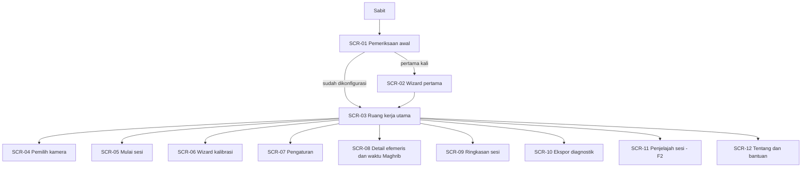
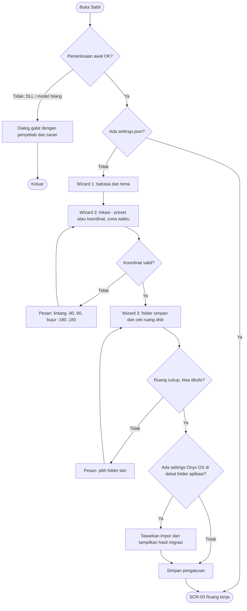
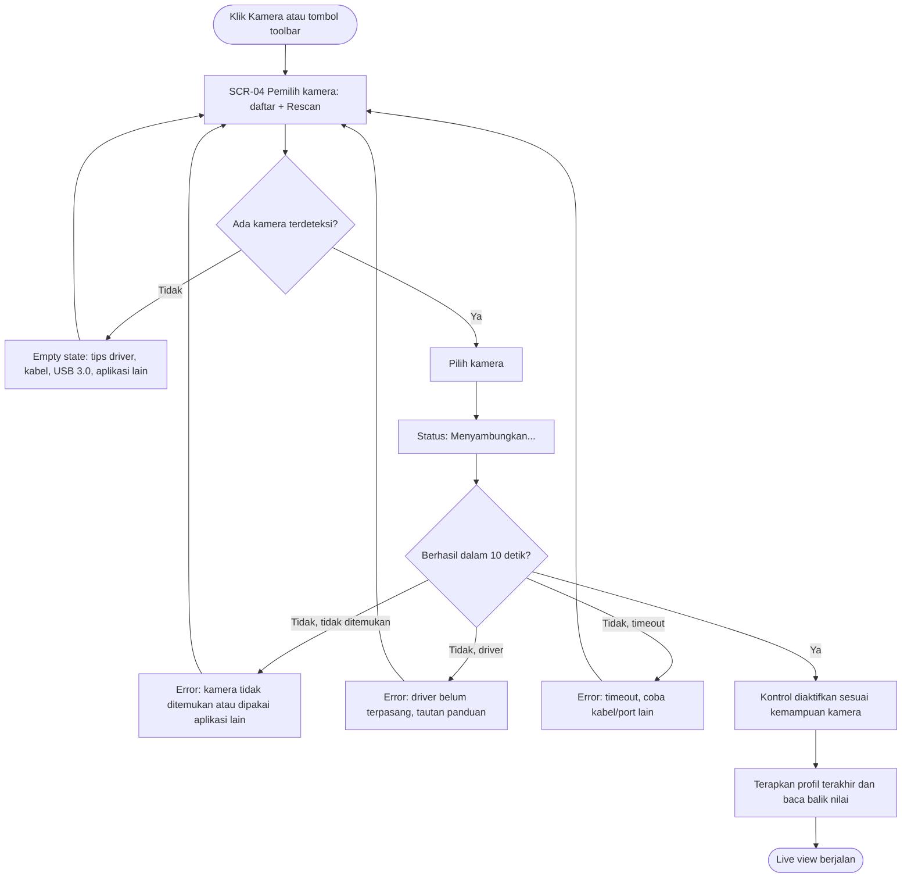
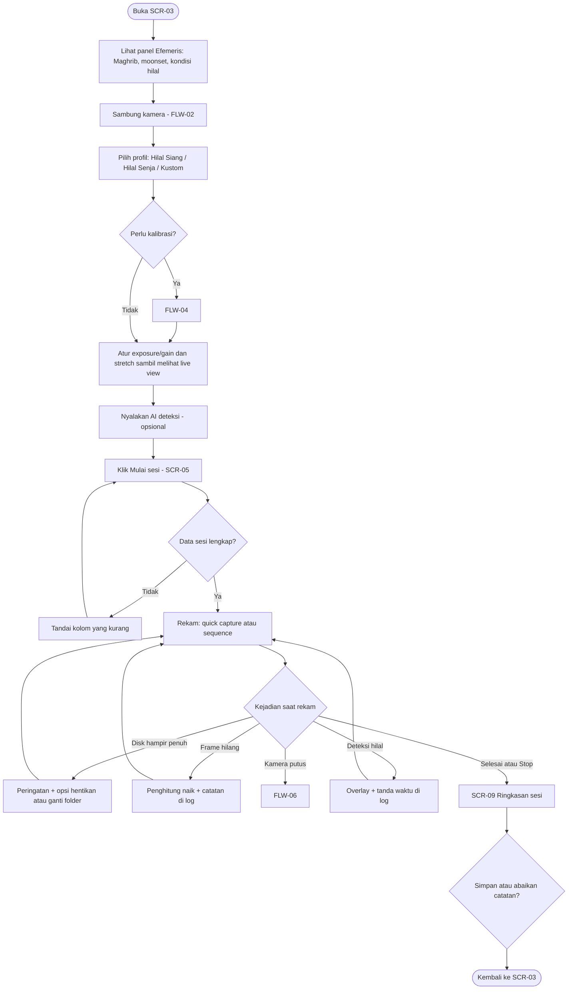
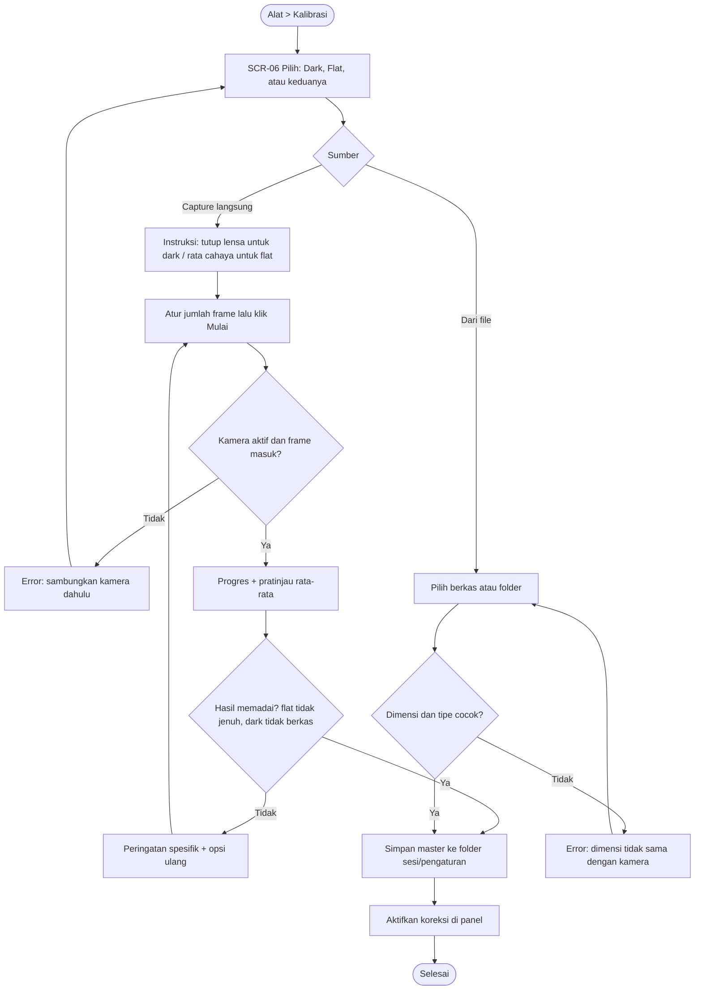
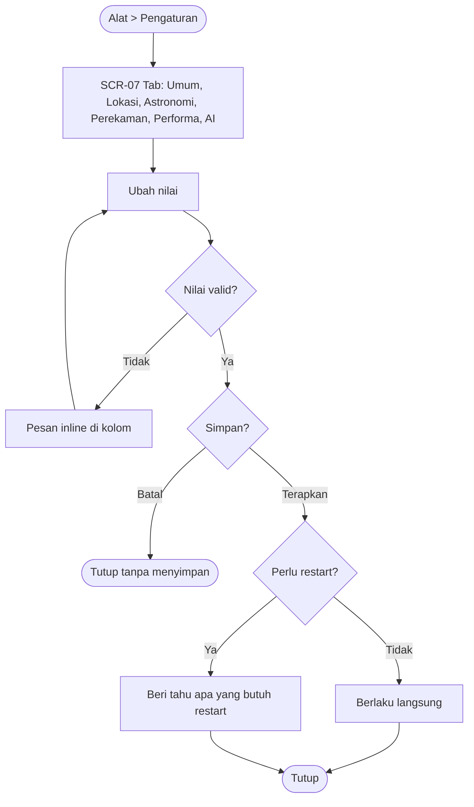
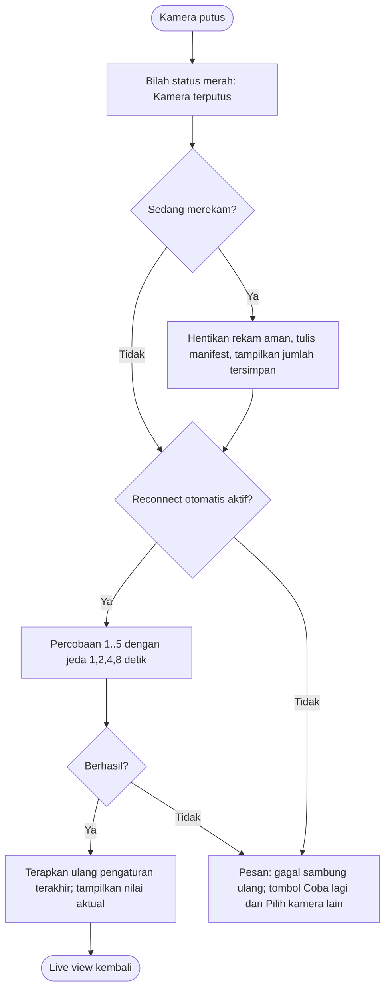

# User Flow & Wireframe: Sabit

Versi dokumen: 0.1 (draf) | Tanggal: 23-10-2026
Rujukan: 01-PRD.md (FR/US), 02-Technical-Specification.md.
Platform: aplikasi desktop Windows (layar laptop 1366x768 sebagai target utama).
ID: SCR-xx (layar), FLW-xx (alur), CMP-xx (komponen).

---

## 1. Tujuan & Prinsip Desain

Pengguna utama bekerja dalam gelap, dalam waktu singkat, dengan tangan di peralatan. Maka:

1. **Gambar adalah isi utama.** Live view memakai ruang terbesar; kontrol berada di panel samping yang dapat dilipat.
2. **Satu tindakan, satu hasil.** Tombol rekam, tombol quick capture, dan sambung kamera tidak butuh langkah tambahan di tengah sesi.
3. **Nilai yang ditampilkan adalah nilai sensor.** Setiap kontrol menampilkan nilai yang dibaca balik dari kamera, bukan nilai yang diketik pengguna.
4. **Kegagalan tidak diam.** Setiap error, frame hilang, dan peringatan disk muncul di tempat yang sama (bilah status) dan dengan kalimat yang jelas.
5. **Mata dilindungi.** Tema Night Red tersedia dari layar pertama; tidak ada elemen putih terang pada tema ini.
6. **Aman dari salah klik.** Tindakan yang menghentikan rekaman atau menghapus data meminta konfirmasi; tindakan lain bisa dibatalkan.

## 2. Information Architecture



Struktur menu: **Berkas** (sesi baru, buka sesi, impor pengaturan Onyx OS, keluar) | **Kamera** (pilih, rescan, sambung ulang, tutup) | **Rekam** (quick capture, mulai/berhenti sequence, buka folder) | **Tampilan** (tema, bahasa, layar penuh, reticle) | **Alat** (kalibrasi, ekspor diagnostik, pengaturan) | **Bantuan** (panduan, tentang).

Catatan: tidak ada layar login, pendaftaran, atau checkout; Sabit adalah aplikasi lokal tanpa akun. Flow "login" dan "checkout" pada template tidak berlaku. Setara fungsinya adalah mulai sesi (SCR-05) dan selesai sesi (SCR-09).

## 3. User Flow Utama

### FLW-01 Pertama kali dibuka (onboarding)



### FLW-02 Sambung kamera



Edge case: kamera dicabut saat dipilih → FLW-06. Dua kamera terhubung → daftar menampilkan keduanya, hanya satu aktif.

### FLW-03 Sesi rukyat (alur inti)



### FLW-04 Kalibrasi dark dan flat



### FLW-05 Ubah pengaturan



### FLW-06 Kamera putus saat dipakai (edge case)



## 4. Daftar Layar

| ID | Nama Layar | Tujuan | Entry Point | Exit Point |
|---|---|---|---|---|
| SCR-01 | Pemeriksaan awal | Memeriksa DLL, model, folder tulis; menampilkan logo singkat | Peluncuran | SCR-02 atau SCR-03; keluar bila gagal |
| SCR-02 | Wizard pertama | Bahasa, tema, lokasi, folder simpan, impor Onyx | SCR-01 (tanpa pengaturan) | SCR-03 |
| SCR-03 | Ruang kerja utama | Live view, kontrol, efemeris, log | SCR-01/SCR-02 | Semua layar lain; keluar |
| SCR-04 | Pemilih kamera | Mendaftar, memilih, dan memutus kamera | Menu Kamera, tombol toolbar | SCR-03 |
| SCR-05 | Mulai sesi | Nama pengamat, target, catatan, folder | Tombol Mulai sesi | SCR-03 (rekam aktif) |
| SCR-06 | Wizard kalibrasi | Membuat atau memuat dark/flat | Alat > Kalibrasi | SCR-03 |
| SCR-07 | Pengaturan | Semua pengaturan aplikasi | Alat > Pengaturan, Ctrl+, | SCR-03 |
| SCR-08 | Detail efemeris | Waktu Maghrib, moonset, tabel kondisi, kriteria | Panel Efemeris > Detail | SCR-03 |
| SCR-09 | Ringkasan sesi | Jumlah frame, hilang, deteksi, lokasi berkas | Berhenti sesi | SCR-03 |
| SCR-10 | Ekspor diagnostik | Membuat ZIP diagnostik | Alat > Ekspor diagnostik | SCR-03 |
| SCR-11 | Penjelajah sesi (F2) | Membuka sesi lama | Berkas > Buka sesi | SCR-03 |
| SCR-12 | Tentang & bantuan | Versi, lisensi pihak ketiga, panduan | Menu Bantuan | SCR-03 |

## 5. Wireframe per Layar

Notasi: `[Tombol]`, `(•) pilihan`, `[x] centang`, `[____]` kolom isian, `▓` area gambar, `░` placeholder.

### SCR-03 Ruang kerja utama (layar terpenting)

```
┌────────────────────────────────────────────────────────────────────────────────────────────┐
│ Berkas  Kamera  Rekam  Tampilan  Alat  Bantuan                                             │
├────────────────────────────────────────────────────────────────────────────────────────────┤
│ [Kamera: ZWO ● ]  [Profil: Hilal Senja ▾]  [Quick Capture]  [● Rekam]  [AI: OFF]  Zoom [1x▾]│
├───────────────────────────────────────────────────────────────┬────────────────────────────┤
│                                                               │ ▾ Histogram                │
│                                                               │   ░░░░░░░░░░░░░░░░░░░░░░   │
│                                                               │ ▾ Efemeris                 │
│                       ▓▓▓▓▓▓▓▓▓▓▓▓▓▓▓▓▓▓                      │   Maghrib   18:14 WIB      │
│                       ▓▓▓  LIVE VIEW  ▓▓▓                      │   Moonset   18:43 WIB      │
│                       ▓▓▓▓▓▓▓▓▓▓▓▓▓▓▓▓▓▓                      │   Alt 6.7°  Elong 8.1°     │
│                                                               │   MABIMS: ✓ MEMENUHI       │
│                                                               │   [Detail...]              │
│                                                               │ ▾ Kamera dan eksposur      │
│                                                               │   Exposure [───●──] 100 ms │
│                                                               │   Gain     [──●───] 200    │
│                                                               │   Bin [1x▾] Bit [16▾]      │
│                                                               │   Suhu -5.2°C  Cooler [ ]  │
│                                                               │ ▸ Pemrosesan citra         │
│                                                               │ ▸ Stacking                 │
│                                                               │ ▸ Kalibrasi                │
│                                                               │ ▸ Deteksi AI               │
│                                                               │ ▸ Log                      │
├───────────────────────────────────────────────────────────────┴────────────────────────────┤
│ Status: Terhubung ZWO | 24.8 fps | latensi 61 ms | hilang 0 | tulis 0 MB/s | disk 212 GB   │
│ UTC 11:01:07 | WIB 18:01:07 | Jam: sinkron 09:12 UTC                                       │
└────────────────────────────────────────────────────────────────────────────────────────────┘
```

**Komponen dan perilaku**
- Bilah status adalah satu-satunya tempat peringatan sistem; teks berubah warna (normal, kuning, merah) dan tidak berkedip.
- Panel kanan terdiri dari bagian yang dapat dilipat (CMP-01); keadaan lipat diingat.
- Slider exposure/gain menampilkan nilai terbaca-balik; selama menunggu konfirmasi dari kamera, nilai tampil redup (pending). Jika kamera menolak, slider kembali ke nilai sebelumnya dan bilah status menjelaskan.
- Tombol Rekam berubah menjadi Berhenti saat sesi aktif; Quick Capture tetap aktif.
- Overlay AI digambar di atas live view; tombol AI memiliki tiga keadaan: OFF, MEMUAT, ON.

**State**

| State | Tampilan |
|---|---|
| Default (tanpa kamera) | Area gambar menampilkan "Tidak ada sinyal kamera" dan tombol [Pilih kamera]; kontrol kamera nonaktif |
| Loading | Area gambar menampilkan "Menyambungkan ke <kamera>..."; tombol Rekam nonaktif |
| Live | Gambar tampil; kontrol aktif sesuai kemampuan; kontrol yang tidak didukung redup dengan tooltip alasannya |
| Merekam | Titik merah di toolbar, penghitung frame dan waktu, kecepatan tulis; pengaturan yang mengubah format dikunci dengan tooltip |
| Empty (tanpa efemeris) | Panel Efemeris: "Lokasi belum diatur" + [Atur lokasi] |
| Error | Bilah status merah dengan pesan dan tombol aksi (Coba lagi, Lihat log) |
| Success | Setelah quick capture: toast 2 detik "Tersimpan: <nama berkas>" di pojok bawah area gambar |

**Interaksi & validasi**
- Pintasan: Ctrl+K pemilih kamera, F5 rescan, Ctrl+Shift+S quick capture, Ctrl+R mulai/berhenti rekam, F11 layar penuh, G reticle, A toggle AI, Ctrl+, pengaturan.
- Zoom memotong pada tampilan saja; rekaman tidak terpengaruh.
- Rekam tidak bisa dimulai jika tidak ada frame masuk dalam 3 detik terakhir.

**Microcopy penting**
- Tidak ada sinyal: "Tidak ada sinyal kamera. Pilih kamera dari menu Kamera atau toolbar."
- Frame hilang: "Beban terlalu tinggi: 3 frame tidak tersimpan. Turunkan resolusi/FPS atau ganti disk."
- Pengaturan ditolak: "Kamera menolak gain 520. Rentang yang didukung: 0 sampai 500."

### SCR-04 Pemilih kamera

```
┌─ Pilih kamera ─────────────────────────────────────┐
│ [Rescan]                                    [Tutup]│
│ ────────────────────────────────────────────────── │
│ Kamera astronomi                                   │
│  (•) ZWO <model dibaca dari SDK>        Tersedia   │
│ Webcam / Capture card                              │
│  ( ) USB Video Device                   Tersedia   │
│ Simulator                                          │
│  ( ) Simulator - Hilal senja                       │
│  ( ) Simulator - Deep sky                          │
│  ( ) Simulator - High speed                        │
│ ────────────────────────────────────────────────── │
│ [Sambungkan]   [Putuskan]                          │
└────────────────────────────────────────────────────┘
```
- **Empty:** "Tidak ada kamera ditemukan. Periksa: driver kamera terpasang, kabel USB (disarankan USB 3.0), aplikasi lain tidak sedang memakai kamera." + tombol [Rescan] dan [Panduan].
- **Loading:** daftar menampilkan "Mencari perangkat..." maksimal 3 detik.
- **Error:** baris kamera berstatus merah dengan sebab; tombol Sambungkan menjadi "Coba lagi".
- Simulator hanya menampilkan mode yang benar-benar tersedia; tidak ada entri yang tidak berfungsi (Onyx OS memiliki "Folder Monitor" palsu).

### SCR-05 Mulai sesi

```
┌─ Mulai sesi ────────────────────────────────────────┐
│ Pengamat   [______________________]  *              │
│ Target     (•) Hilal  ( ) Bulan  ( ) Lainnya [____] │
│ Lokasi     Jakarta (-6.2088, 106.8456)   [Ubah]     │
│ Folder     D:\Captures                   [Pilih...] │
│            Ruang kosong: 212 GB                     │
│ Format     [FITS 16-bit ▾]                          │
│ Catatan    [____________________________________]   │
│ [x] Cegah laptop tidur selama sesi                  │
│                         [Batal]   [Mulai rekam]     │
└─────────────────────────────────────────────────────┘
```
- Validasi: Pengamat wajib; folder harus bisa ditulis dan ruang ≥ 2 GB; jika kurang, kolom berwarna merah dengan pesan.
- Loading: tombol "Menyiapkan sesi..." saat folder dan manifest dibuat.
- Error: "Folder tidak bisa ditulis. Pilih folder lain."

### SCR-06 Wizard kalibrasi

```
┌─ Kalibrasi (langkah 1 dari 3) ─────────────────────┐
│ Jenis:  (•) Dark   ( ) Flat   ( ) Keduanya         │
│ Sumber: (•) Capture dari kamera  ( ) Dari berkas   │
│ Jumlah frame [ 20 ]                                │
│ Petunjuk: Tutup lensa/teleskop rapat. Gunakan      │
│ exposure dan gain yang sama dengan pengamatan.     │
│                    [Batal] [Kembali] [Mulai]       │
└────────────────────────────────────────────────────┘
```
- Loading: bilah progres "12 dari 20 frame" + pratinjau rata-rata.
- Peringatan hasil: "Flat jenuh pada 4% piksel. Kurangi exposure dan ulangi."
- Success: "Master flat dibuat dari 20 frame. Aktifkan koreksi?" [Aktifkan] [Nanti].

### SCR-07 Pengaturan

```
┌─ Pengaturan ───────────────────────────────────────────────┐
│ [Umum] [Lokasi] [Astronomi] [Perekaman] [Performa] [AI]    │
│ ────────────────────────────────────────────────────────── │
│ Bahasa   [Indonesia ▾]       Tema [Night Red ▾]            │
│ [x] Cegah tidur saat sesi                                  │
│ [x] Sambung ulang otomatis bila kamera putus               │
│ Profil capture: [Hilal Siang] [Hilal Senja] [Tambah...]    │
│ ────────────────────────────────────────────────────────── │
│ [Impor dari Onyx OS...] [Ekspor] [Kembalikan default]      │
│                                      [Batal] [Terapkan]    │
└────────────────────────────────────────────────────────────┘
```
- Tab Lokasi: preset, lintang, bujur, elevasi, zona waktu, refraksi; validasi rentang; ringkasan "Bulan terbit di sini pada ...".
- Tab Astronomi: pilih kriteria; menampilkan ambang dan rumus yang dipakai.
- Tab Performa: ukuran ring buffer, RAM stacking, frekuensi AI; ada teks "Memerlukan restart" pada yang memerlukannya.
- Hanya pengaturan yang benar-benar dipakai aplikasi yang tampil (tidak ada kolom tanpa efek).

### SCR-08 Detail efemeris

```
┌─ Efemeris - Jakarta, 07-02-2027 ───────────────────────────┐
│ Maghrib 18:14 WIB    Moonset 18:43 WIB   Selisih 29 mnt    │
│ Kondisi saat Maghrib:                                       │
│   Tinggi bulan 6.7°   Elongasi 8.1°   Umur 19.3 jam        │
│ Waktu terbaik pengamatan: <dihitung aplikasi>              │
│ Kriteria (MABIMS baru): alt ≥ 3.0°, elong ≥ 6.4°  → ✓      │
│ Kriteria lain: [Odeh: ...] [BRIN: ...]                     │
│ Ijtima: 06-02-2027 22:56 WIB                               │
│ Kalender: <metode>   Tanggal Hijriyah: <hasil>             │
│                                              [Tutup]       │
└────────────────────────────────────────────────────────────┘
```
Angka di wireframe adalah contoh tata letak (dihitung dengan PyEphem untuk Jakarta, tanpa refraksi, 07-02-2027) dan harus diverifikasi ulang oleh aplikasi; bukan hasil resmi. Catatan di bagian bawah layar: "Alat bantu pengamatan. Penetapan resmi oleh otoritas."

### SCR-09 Ringkasan sesi

```
┌─ Sesi selesai ─────────────────────────────────────┐
│ Durasi 00:42:10     Frame tersimpan 1240           │
│ Frame hilang 0      Deteksi 31                     │
│ Folder: D:\Captures\2027-02-07_Jakarta_hilal       │
│ Catatan akhir [____________________________]       │
│ [Buka folder]   [Ekspor diagnostik]   [Selesai]    │
└────────────────────────────────────────────────────┘
```
Bila ada frame hilang: baris "Frame hilang" berwarna kuning dengan tautan "Penyebab".

### SCR-10 Ekspor diagnostik

```
┌─ Ekspor diagnostik ────────────────────────────────┐
│ Sertakan: [x] Log  [x] Manifest sesi  [x] Pengaturan│
│           [x] Info sistem  [ ] Frame contoh        │
│ [x] Samarkan koordinat lokasi                      │
│ Simpan ke: [C:\Users\...\Desktop\sabit-diag.zip]   │
│                      [Batal]  [Buat paket]         │
└────────────────────────────────────────────────────┘
```

### SCR-01, SCR-02, SCR-11, SCR-12 (ringkas)
- **SCR-01:** logo dan teks "Memeriksa komponen...". Tidak ada penundaan buatan. Jika ada komponen hilang: dialog galat dengan nama berkas yang hilang dan satu tombol [Keluar].
- **SCR-02:** tiga langkah dengan indikator "Langkah 2 dari 3", tombol Kembali/Lanjut, dan Lewati hanya pada impor.
- **SCR-11 (F2):** daftar sesi (tanggal, lokasi, jumlah frame, deteksi), pratinjau sesi, [Buka folder], [Ekspor ringkasan].
- **SCR-12:** versi, hash build, daftar lisensi pihak ketiga, tautan panduan.

## 6. Navigasi & Pola Interaksi

- Navigasi utama lewat menu dan toolbar; ruang kerja utama selalu terlihat (dialog bersifat modal hanya bila perlu).
- Tindakan destruktif (berhenti rekam sebelum selesai, kembalikan default, hapus profil) meminta konfirmasi; konfirmasi menyebut akibatnya dengan angka (misalnya "1.240 frame sudah tersimpan").
- Konfirmasi tidak dipakai untuk tindakan yang bisa dibatalkan (ubah tema, ubah zoom).
- Umpan balik: perubahan hardware menunjukkan keadaan pending lalu nilai terkonfirmasi; tindakan panjang menunjukkan progres.
- Pesan galat memuat apa yang terjadi, kemungkinan penyebab, dan tindakan berikutnya.

## 7. Responsivitas

Aplikasi desktop; "responsif" berarti lebar jendela dan skala DPI.

| Lebar jendela | Layout |
|---|---|
| ≥ 1600 px | Live view + panel kanan 360 px + dock Log di bawah (opsional) |
| 1280 sampai 1599 px | Live view + panel kanan 320 px; Log menjadi bagian lipat |
| 1120 sampai 1279 px (minimum) | Panel kanan 300 px; label toolbar menjadi ikon + tooltip |
| < 1120 px | Tidak didukung; jendela tidak bisa diperkecil lebih jauh |

Skala DPI 100% sampai 200%: ikon vektor (SVG) agar tajam; ukuran teks mengikuti sistem.

## 8. Aksesibilitas

- Kontras: teks utama minimal 4,5:1 pada Dark dan Light; Night Red dihitung dalam palet merah dan hasilnya dicatat di dokumen tema. Warna tidak menjadi satu-satunya penanda (status juga memakai ikon/teks).
- Fokus keyboard: urutan Tab logis (toolbar, panel kanan, area gambar); fokus terlihat jelas (kontur 2 px).
- Pintasan keyboard untuk semua fungsi inti (lihat SCR-03); pintasan tidak boleh bentrok dengan pintasan sistem.
- Nama aksesibel (`accessibleName`) pada semua kontrol; slider memiliki nilai dan satuan terbaca pembaca layar.
- Target klik minimal 40x40 px pada toolbar dan tombol utama (laptop layar sentuh).
- Animasi minimal; tidak ada elemen berkedip yang cepat.
- Bahasa: Indonesia dan Inggris lengkap.

## 9. Komponen Reusable

| ID | Komponen | Dipakai di | Catatan |
|---|---|---|---|
| CMP-01 | Bagian lipat (CollapsibleSection) | SCR-03 | Ikon expand/collapse, keadaan diingat |
| CMP-02 | Slider bernilai terkonfirmasi | Eksposur, gain, stretch | Tiga keadaan: pending, terkonfirmasi, ditolak |
| CMP-03 | Bilah status | SCR-03 | Satu sumber peringatan; tiga level |
| CMP-04 | Tampilan video + overlay | SCR-03 | Layer overlay terpisah dari pixmap |
| CMP-05 | Histogram | SCR-03 | Per kanal, penanda black/white |
| CMP-06 | Dialog galat standar | Semua | Penyebab + tindakan + tombol Salin detail |
| CMP-07 | Toast | SCR-03 | 2 detik, tidak menghalangi |
| CMP-08 | Kolom isian tervalidasi | SCR-02, 05, 07 | Pesan inline |
| CMP-09 | Indikator status kamera | Toolbar | Titik berwarna + teks |
| CMP-10 | Pemilih tema | SCR-02, 07 | Pratinjau langsung |

## 10. Catatan untuk Developer & Open Questions

**Catatan**
- Token warna dan jarak diambil dari `theme.py` Onyx OS (Dark Onyx, Night Vision Red, Light System) lalu dipindahkan ke JSON token; QSS dihasilkan dari token.
- Panel Efemeris, Kamera, dan Log harus bisa diuji tanpa kamera (kamera simulator).
- Seluruh teks lewat sistem terjemahan; wireframe memakai Bahasa Indonesia sebagai sumber.
- Overlay AI merujuk `frame_seq`; jangan menggambar overlay yang lebih tua dari 500 ms.

**Open Questions**
1. Apakah layar sentuh/tablet termasuk perangkat target? (mempengaruhi ukuran target klik)
2. Perlu mode tampilan "hanya gambar" untuk presentasi/proyektor dengan bilah minimal?
3. Apakah dibutuhkan suara/nada peringatan (misalnya saat deteksi) mengingat konteks lapangan?
4. Format penamaan sesi dan berkas yang diinginkan tim falak.
5. Apakah reticle perlu skala sudut (derajat) berdasarkan panjang fokus? (Onyx menyimpan focal length tetapi tidak memakainya)
