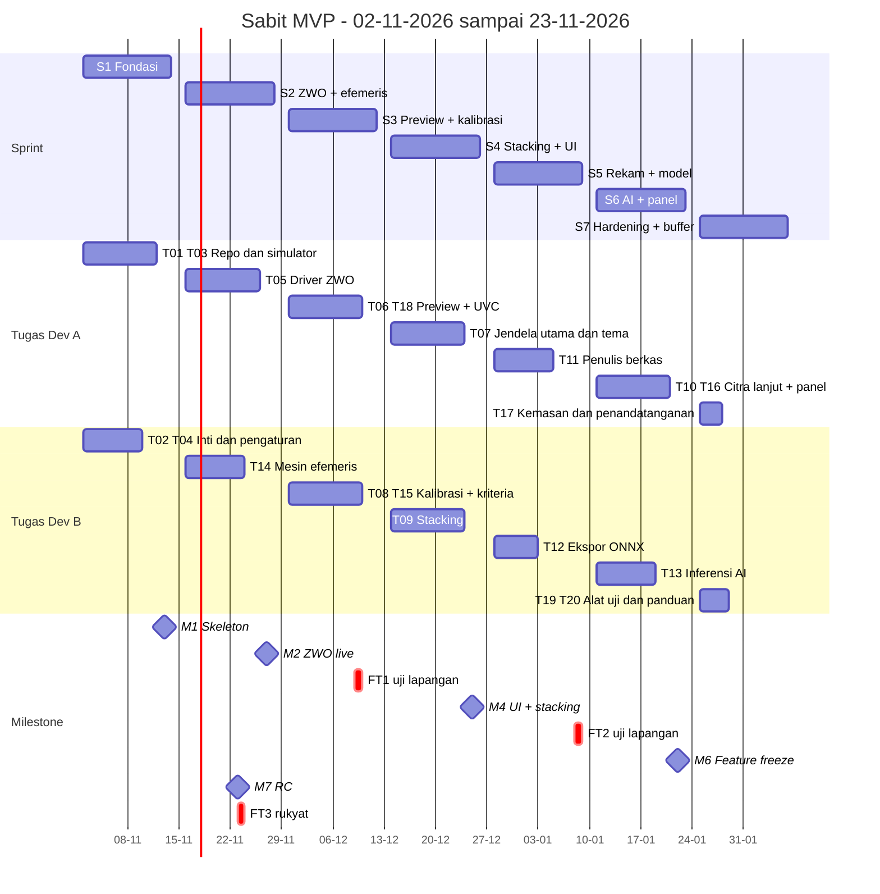

# Project Timeline & Milestones: Sabit

Versi dokumen: 0.1 (draf) | Tanggal: 23-10-2026 | Format tanggal: DD-MM-YYYY
Metodologi: Scrum ringan, sprint 2 minggu.
Rujukan: 01-PRD.md (FR/NFR/G), 02-Technical-Specification.md.

---

## 1. Ringkasan Proyek & Tujuan

Membangun Sabit MVP 1.0 (rebuild Onyx OS) agar dapat dipakai pada malam rukyat yang diperkirakan jatuh pada **10-11-2026** (awal Rabiul Akhir 1448 H; ASUMSI dari perhitungan sendiri untuk lokasi Jakarta, penetapan resmi oleh otoritas).

Keputusan jadwal yang perlu persetujuan: **hanya MVP yang feasible untuk tanggal itu.** Cakupan penuh (termasuk QHY, ASCOM, video, penjelajah sesi) membutuhkan sekitar 2 minggu tambahan dan ditempatkan di fase 2 (lihat bagian 11 dan 12).

### Dasar perhitungan kapasitas (ASUMSI)

- Tim: 2 developer. **Dev A** (platform, kamera, UI, kemasan) dan **Dev B** (pencitraan, AI, astronomi). Masing-masing 4 person-day (pd) produktif per minggu.
- Penasihat falak: 4 jam per minggu (tidak dihitung dalam pd developer).
- Tester lapangan: dua sampai tiga orang pada tanggal uji lapangan.
- Kapasitas per developer per sprint: 8 pd (sprint 4 dan 5 hanya 7 pd karena 25-12-2026 dan 01-01-2027 hari libur nasional).
- Jika ketersediaan sebenarnya berbeda, seluruh angka di bawah harus dihitung ulang.

## 2. Work Breakdown Structure (WBS)

Estimasi dalam person-day (pd), belum termasuk buffer. Owner = Dev A atau Dev B.

**Fase 0: Fondasi**

| Task | Deskripsi | pd | Owner | Terkait |
|---|---|---|---|---|
| T01 | Repo, CMake, vcpkg manifest, CI build Windows | 3 | A | NFR-09 |
| T02 | Tipe inti: `Frame`, `RingBuffer`, `LatestSlot`, `Clock`, logging | 4 | B | FR-13 |
| T03 | Antarmuka `ICamera` + kamera simulator 16-bit (3 mode) | 4 | A | FR-03 |
| T04 | Pengaturan v2 (JSON, migrasi, impor Onyx) | 2 | B | FR-31 |

**Fase 1: Capture dan tampilan**

| Task | Deskripsi | pd | Owner | Terkait |
|---|---|---|---|---|
| T05 | Driver ZWO native + antrean perintah + capabilities + baca-balik | 8 | A | FR-01, FR-04, FR-05 |
| T06 | Jalur preview: konversi 16 ke 8-bit, stretch dasar, widget tampilan | 5 | A | FR-08, FR-09 |
| T18 | Driver UVC (webcam/capture card) | 3 | A | FR-02 |
| T07 | Jendela utama, panel, tema (Dark/Night Red/Light), i18n | 6 | A | FR-28, FR-29 |

**Fase 2: Pemrosesan dan perekaman**

| Task | Deskripsi | pd | Owner | Terkait |
|---|---|---|---|---|
| T08 | Kalibrasi dark/flat (file dan capture), float/16-bit | 5 | B | FR-11 |
| T09 | Live stacking: alignment, akumulator, sigma-clip, batas RAM | 7 | B | FR-12 |
| T10 | CLAHE, sharpen, invert, histogram live, stretch manual/auto lanjutan | 4 | A | FR-09, FR-10 |
| T11 | Penulis berkas: FITS 16-bit + metadata, TIFF, PNG, sesi, manifest, indikator rekam | 5 | A | FR-14, FR-15, FR-17, FR-18 |

**Fase 3: Deteksi AI**

| Task | Deskripsi | pd | Owner | Terkait |
|---|---|---|---|---|
| T12 | Ekspor model ke ONNX + uji paritas dengan model asli | 4 | B | G-05 |
| T13 | Thread inferensi ONNX, letterbox, NMS, overlay, log deteksi | 6 | B | FR-19 sampai FR-22 |

**Fase 4: Astronomi**

| Task | Deskripsi | pd | Owner | Terkait |
|---|---|---|---|---|
| T14 | Mesin efemeris (topocentric, sunset/moonset, ijtima, umur, elongasi) + golden test | 6 | B | FR-23, FR-24, G-08 |
| T15 | Kriteria sebagai data (MABIMS, BRIN, Odeh), kalender Hijriyah | 3 | B | FR-25, FR-26 |
| T16 | Panel efemeris, waktu, lokasi/zona waktu, cegah tidur, panel waktu | 4 | A | FR-27, FR-32, FR-35 |

**Fase 5: Penyelesaian**

| Task | Deskripsi | pd | Owner | Terkait |
|---|---|---|---|---|
| T17 | Kemasan ZIP portabel, penandatanganan, SBOM, checksum | 3 | A | NFR-09, NFR-13 |
| T19 | Alat uji lapangan: paket diagnostik, mode `--perf` | 2 | B | FR-33 |
| T20 | Panduan pengguna dan README final | 2 | B | - |

Ringkasan: Dev A = 45 pd, Dev B = 41 pd, total **86 pd**. Dev A tepat di batas kapasitas (45 x 1,2 = 54 pd dari 54 pd tersedia), jadi Dev A adalah bottleneck; T19 sengaja dipindah ke Dev B untuk menyeimbangkan beban.

## 3. Milestone

| ID | Milestone | Deliverable | Kriteria Selesai | Target |
|---|---|---|---|---|
| M0 | Kickoff | Rencana disetujui, kamera uji tersedia, set data model diaudit | Open Questions 2, 3, 8, 9 PRD terjawab atau punya owner | 02-11-2026 |
| M1 | Walking skeleton | Simulator -> ring buffer -> preview Qt; CI hijau | Build CI dari nol; FPS preview simulator tercatat | 13-11-2026 |
| M2 | ZWO live + efemeris terverifikasi | Driver ZWO, antrean perintah, mesin efemeris | G-04 terpenuhi pada kamera uji; G-08 terpenuhi terhadap tabel referensi | 27-11-2026 |
| M3 | Alpha + uji lapangan 1 | Preview ZWO/UVC, kalibrasi, panel dasar | FT1 (09-12-2026) selesai tanpa crash; latensi p95 tercatat | 11-12-2026 |
| M4 | UI lengkap + stacking | Stacking live, jendela utama, tema | Uji unit stacking lulus; semua panel terpasang | 25-12-2026 |
| M5 | Beta + uji lapangan 2 | Rekam FITS 16-bit, sesi, manifest; model ONNX | FT2 (08-01-2027) selesai; G-05 diukur; G-02 diukur di laptop referensi | 08-01-2027 |
| M6 | Feature freeze | AI live, efemeris panel, cegah tidur, diagnostik | Semua FR MVP "Must" berstatus selesai di build uji | 22-01-2027 |
| M7 | Release Candidate | RC ditandatangani, regresi lulus, panduan | Tidak ada bug severity 1/2 terbuka; G-01, G-02, G-03, G-07 lulus | 23-11-2026 |
| M8 | Pemakaian lapangan pertama | Sesi rukyat dengan Sabit | FT3 (23-11-2026) selesai dengan catatan hasil | 23-11-2026 |

Catatan uji lapangan: tanggal ditentukan oleh ijtima dan posisi bulan (dihitung dengan PyEphem, Jakarta, tanpa refraksi; verifikasi ulang dengan efemeris lain). Kondisi bulan pada saat Maghrib:

| Uji | Tanggal | Ijtima (UTC) | Ketinggian bulan | Elongasi | Umur | Catatan |
|---|---|---|---|---|---|---|
| FT1 | 09-12-2026 | 09-12-2026 00:51 | 3,5 derajat | 5,7 derajat | 10,1 jam | Sulit: di bawah ambang elongasi MABIMS; cocok untuk uji sensitivitas |
| FT2 | 08-01-2027 | 07-01-2027 20:24 | 5,8 derajat | 6,1 derajat | 14,8 jam | Sulit: elongasi di bawah 6,4; uji rekam dan stacking |
| FT2b (opsional) | 10-01-2027 | - | - | - | sekitar 2 hari | Bulan sabit muda biasa, mudah; uji AI dan eksposur pada target nyata |
| FT3 | 23-11-2026 | 06-02-2027 15:56 | 6,7 derajat | 8,1 derajat | 19,3 jam | Perkiraan malam rukyat awal Ramadan 1448 H; kriteria MABIMS terpenuhi menurut hitungan ini |

Catatan: pada 06-02-2027 ijtima terjadi setelah Maghrib, sehingga pengamatan hilal pada malam itu tidak mungkin; target sesungguhnya adalah malam berikutnya.

## 4. Timeline

### Gantt (Mermaid)

### Jadwal per fase

| Fase | Mulai | Selesai | Isi |
|---|---|---|---|
| Fase 0 Fondasi | 02-11-2026 | 13-11-2026 | T01 sampai T04 |
| Fase 1 Capture dan tampilan | 16-11-2026 | 11-12-2026 | T05, T06, T18 (T07 dimulai 14-12-2026) |
| Fase 2 Pemrosesan dan rekam | 30-11-2026 | 08-01-2027 | T08, T09, T10, T11 |
| Fase 3 AI | 28-12-2026 | 22-01-2027 | T12, T13 |
| Fase 4 Astronomi | 16-11-2026 | 22-01-2027 | T14, T15, T16 |
| Fase 5 Penyelesaian | 25-01-2027 | 23-11-2026 | T17, T19, T20 + buffer |

## 5. Rencana Sprint / Iterasi

Kapasitas per sprint dihitung per developer (8 pd; 7 pd pada S4 dan S5). Beban dalam pd tanpa buffer.

| Sprint | Tanggal | Goal | Dev A | Dev B | Beban A / B |
|---|---|---|---|---|---|
| S1 | 02-11 sampai 13-11-2026 | Walking skeleton berjalan di CI | T01, T03 | T02, T04 | 7 / 6 |
| S2 | 16-11 sampai 27-11-2026 | Kamera ZWO dikontrol nyata; efemeris terverifikasi | T05 | T14 | 8 / 6 |
| S3 | 30-11 sampai 11-12-2026 | Alpha lapangan: preview ZWO/UVC dan kalibrasi; FT1 | T06, T18 | T08, T15 | 8 / 8 |
| S4 | 14-12 sampai 25-12-2026 | UI lengkap dan stacking live | T07 | T09 | 6 / 7 |
| S5 | 28-12-2026 sampai 08-01-2027 | Rekam FITS 16-bit dan model ONNX; FT2 | T11 | T12 | 5 / 4 |
| S6 | 11-01 sampai 22-01-2027 | AI live, panel efemeris, citra lanjut; feature freeze | T10, T16 | T13 | 8 / 6 |
| S7 | 25-01 sampai 23-11-2026 | Hardening, kemasan, panduan, RC | T17 | T19, T20 | 3 / 4 |

Catatan:
- Sprint 4 B memiliki beban 7 dari 7 pd, tanpa ruang tersisa. Ini sprint paling berisiko; jika meleset, T09 mundur ke S5 (kapasitas B tersedia 3 pd) tanpa mengubah FT2.
- Dev A terisi 45 dari 54 pd (tanpa ruang cadangan sendiri); Dev B terisi 41 dari 54 pd. Dev B memiliki kapasitas lebih pada S5, S6, dan S7. Ruang itu dipakai untuk review silang dan perbaikan temuan uji lapangan.

## 6. Estimasi Effort

| Item | Nilai |
|---|---|
| Effort bersih (WBS) | 86 pd |
| Buffer 20% | 17,2 pd |
| Total dengan buffer | 103,2 pd |
| Kapasitas S1 sampai S6 | 92 pd (2 developer) |
| Kapasitas S7 | 16 pd |
| Total kapasitas | 108 pd |
| Margin di atas total dengan buffer | 4,8 pd (sekitar 4,4%) |

Efektif, buffer di jadwal adalah (92 - 79) + (16 - 7) = 22 pd (25,6% dari effort bersih), karena T17, T19, T20 (7 pd) berada di sprint terakhir dan sisa kapasitas S1 sampai S6 tidak terpakai penuh. Margin sempit, jadi tidak ada ruang untuk menambah cakupan.

## 7. Alokasi Sumber Daya

| Orang | Peran | Tanggung jawab | Ketersediaan |
|---|---|---|---|
| Dev A | Platform, kamera, UI, kemasan | T01, T03, T05, T06, T07, T10, T11, T16, T17, T18 | 4 pd/minggu |
| Dev B | Pencitraan, AI, astronomi | T02, T04, T08, T09, T12, T13, T14, T15, T19, T20 | 4 pd/minggu |
| Penasihat falak | Verifikasi rumus dan hasil | Review T14, T15 (kriteria), verifikasi hasil FT | 4 jam/minggu |
| Tester lapangan (2 sampai 3 orang) | Uji FT1, FT2, FT3 | Menjalankan skenario uji, mengisi laporan | Pada tanggal FT |
| Pemilik produk | Prioritas dan keputusan | Menjawab Open Questions, menerima milestone | 2 jam/minggu |

## 8. Critical Path & Dependensi

Critical path:

T01 -> T03 -> T05 (driver ZWO) -> T06 (preview) -> FT1 -> T11 (penulis berkas) -> FT2 -> T13 (AI live) -> M6 -> T17 -> M7 -> FT3.

Cabang paralel yang tidak boleh terlambat:
- T14 -> T15 -> T16 (astronomi) harus selesai sebelum 22-01-2027.
- T12 (ONNX) harus selesai sebelum T13.

Dependensi eksternal:

| Dependensi | Dibutuhkan pada | Tanggal | Akibat jika terlambat |
|---|---|---|---|
| Kamera ZWO uji + laptop referensi | T05 | 16-11-2026 | T05 mundur sama panjang; FT1 terancam |
| Lisensi redistribusi SDK ZWO | T17 | 25-01-2027 | Kemasan tidak boleh menyertakan DLL; pengguna menginstal driver sendiri |
| Dataset dan lisensi model | T12 | 28-12-2026 | AI tertunda atau memakai model sementara |
| Penasihat falak untuk rumus Odeh/BRIN | T15 | 30-11-2026 | Hanya MABIMS dirilis; Odeh/BRIN menunggu |
| Sertifikat tanda tangan kode | T17 | 25-01-2027 | RC tidak bertanda tangan (ditandai jelas) |

## 9. Risiko & Mitigasi

| ID | Risiko | Probabilitas | Dampak | Mitigasi | Owner |
|---|---|---|---|---|---|
| R-04 | MVP meleset dari 23-11-2026 | Tinggi | Tinggi | Scope dikunci; QHY/ASCOM/video ke F2; pantau burndown mingguan; pemotongan fitur terurut: CLAHE/sharpen (FR-10), median/sum (FR-12), Odeh/BRIN (FR-25) | Pemilik produk |
| R-01 | SDK ZWO bermasalah | Sedang | Tinggi | Spike di awal S2; jalur UVC dan simulator sebagai cadangan | Dev A |
| R-02 | ONNX berbeda hasil | Sedang | Tinggi | Uji paritas di S5; tetap mendukung model referensi | Dev B |
| R-03 | Lisensi model/pelatihan | Sedang | Tinggi | Tinjauan hukum sebelum 28-12-2026 | Pemilik produk |
| R-05 | Rumus kriteria salah | Sedang | Tinggi | Verifikasi tertulis penasihat falak; golden test | Dev B |
| R-06 | Laptop lapangan lemah | Sedang | Sedang | Uji pada laptop terlemah sebelum M5; mode ringan | Dev A |
| R-07 | Kebutuhan Administrator | Sedang | Sedang | Selidiki di S2; dokumentasi driver | Dev A |
| R-08 | Sedikit kesempatan uji lapangan | Tinggi | Sedang | FT2b, rekaman lama, simulator | Dev B |
| R-09 | Cuaca menggagalkan FT | Tinggi | Sedang | Tanggal cadangan: FT1 10-12-2026, FT2 09-01-2027; simulator dan Bulan sebagai pengganti | Pemilik produk |
| R-10 | Developer sakit atau cuti | Sedang | Tinggi | Review silang agar tiap modul punya dua orang yang paham; buffer 22 pd | Pemilik produk |
| R-11 | Perubahan cakupan di tengah jalan | Sedang | Tinggi | Perubahan melalui permintaan tertulis; tiap tambahan dibayar dengan pengurangan | Pemilik produk |

## 10. Rencana Komunikasi

| Ritual | Frekuensi | Peserta | Keluaran |
|---|---|---|---|
| Stand-up singkat | Senin, Rabu, Jumat, 15 menit | Dev A, Dev B | Blocker dan rencana hari |
| Perencanaan sprint | Hari pertama sprint, 60 menit | Tim + pemilik produk | Goal dan backlog sprint |
| Demo dan review | Hari terakhir sprint, 45 menit | Tim + penasihat falak | Keputusan terima/tolak |
| Retrospektif | Sesudah demo, 30 menit | Tim | Tiga perbaikan |
| Laporan progres | Jumat, tertulis | Dev B menyusun | Burndown, risiko, keputusan yang dibutuhkan |
| Eskalasi | Kapan saja | Dev ke pemilik produk | Blocker lebih dari 2 hari kerja atau risiko R-xx naik level |
| Laporan uji lapangan | Sehari setelah FT | Tester + Dev | Temuan, rekaman, keputusan perbaikan |

Aturan beku rilis: tidak ada rilis ke lapangan 7 hari sebelum malam rukyat kecuali perbaikan bug severity 1 yang sudah lewat regresi. Berlaku untuk 23-11-2026, sehingga RC harus siap 23-11-2026 dengan bekuan kode 31-01-2027 (RC hanya menerima perbaikan severity 1).

## 11. Definition of Done per Fase

- **Task selesai** (semua fase): kode ditinjau oleh developer lain; tes otomatis lulus di CI; tidak ada peringatan kompilasi baru; dokumentasi singkat diperbarui; acceptance criteria FR terkait terpenuhi atau diuji manual dan dicatat.
- **Fase 0:** CI membangun dari klon bersih; simulator menghasilkan frame 16-bit; pengaturan v2 dapat dimuat dan dimigrasi.
- **Fase 1:** kamera ZWO uji dikontrol dengan baca-balik; status koneksi dan putus benar; preview tanpa antrean.
- **Fase 2:** stacking lulus uji outlier; FITS berisi metadata dari hardware; kill proses tidak merusak sesi sebelumnya.
- **Fase 3:** paritas ONNX terukur (selisih mAP50 ≤ 1 poin); AI tidak menurunkan FPS preview lebih dari 5%; rekaman bersih (selisih piksel nol).
- **Fase 4:** golden test efemeris lulus (G-08); kriteria terdokumentasi rumus dan sumbernya; peninjauan ahli falak tertulis.
- **Fase 5:** ZIP bertanda tangan dan checksum; regresi penuh lulus; smoke test pasca-build lulus di Windows bersih; panduan pengguna tersedia.

## 12. Metrik Pemantauan

| Metrik | Definisi | Pemantauan | Ambang perhatian |
|---|---|---|---|
| Velocity | pd selesai per sprint | Tiap review sprint | Di bawah 85% rencana dua sprint berturut-turut |
| Burndown | pd tersisa terhadap garis ideal | Mingguan | Selisih > 10% dari garis ideal |
| Defect rate | Bug baru per 10 pd | Mingguan | > 3 per 10 pd |
| Bug terbuka severity 1/2 | Jumlah | Harian menjelang RC | > 0 pada 23-11-2026 memblokir RC |
| Coverage `core`/`imaging`/`astro` | Persen baris | CI | < 80% |
| Latensi p95 preview | ms, benchmark | Tiap sprint pada laptop referensi | > 100 ms |
| Frame hilang saat rekam | Persen | Tiap uji beban | > 1% |
| Kesiapan lapangan | Sesi FT tanpa crash | Per FT | Ada crash |

## 13. Opsi jika Deadline Tidak Feasible

Jika ketersediaan developer lebih rendah dari asumsi (misalnya 3 pd/minggu), kapasitas total turun menjadi sekitar 81 pd dan MVP tidak lagi cukup untuk 23-11-2026 dengan buffer. Opsi:

1. **Kurangi cakupan.** Keluarkan FR-10 (CLAHE/sharpen/invert), FR-12 median/sum, FR-25 Odeh/BRIN, FR-26, FR-33, FR-35. Menghemat sekitar 10 sampai 12 pd.
2. **Tambah sumber daya.** Tambah satu developer pada S3 sampai S6 (kontribusi 4 pd/minggu setelah onboarding); mengambil T10, T16, dan sebagian T11.
3. **Geser tanggal.** Pemakaian lapangan pertama bergeser ke malam rukyat berikutnya yang memungkinkan secara hitungan (ijtima 08-03-2027; menurut hitungan di dokumen ini, pengamatan efektif pada 09-03-2027). Mengorbankan penggunaan pada malam awal Ramadan.

Rekomendasi: opsi 1 lebih dahulu, karena fitur yang dikeluarkan tidak mengubah fungsi inti rukyat. Opsi 2 bila ada anggaran. Opsi 3 hanya bila opsi 1 dan 2 tidak mungkin; Onyx OS tetap dipakai sebagai cadangan pada malam 23-11-2026 selama Sabit belum lolos FT3.

## 14. Fase Lanjutan (di luar MVP)

| Fase | Isi | Estimasi |
|---|---|---|
| Fase 2 (v1.1) | Driver QHY (6 pd), driver ASCOM (6 pd), rekam video (3 pd), penjelajah sesi + laporan PDF (7 pd), perbaikan dari FT3 (10 pd) | sekitar 32 pd, 4 sampai 5 minggu setelah 08-02-2027 |
| Fase 3 | Kontrol mount ASCOM/Alpaca (8 pd), profil kamera tambahan, perbaikan model | Ditentukan setelah evaluasi |

## 15. Open Questions

1. Konfirmasi ketersediaan 4 pd/minggu per developer dan jadwal cuti November 2026 sampai Februari 2027.
2. Siapa pemilik produk yang menyetujui milestone dan pemotongan cakupan?
3. Apakah uji lapangan boleh dilakukan di lokasi selain Jakarta (kondisi langit lebih baik)? Perhitungan di dokumen ini memakai Jakarta karena itu preset Onyx OS.
4. Apakah ada kegiatan rukyat resmi lain (misalnya awal Syawal) yang menjadi target kedua?
