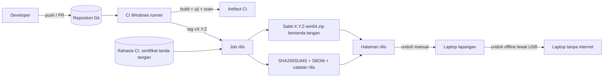
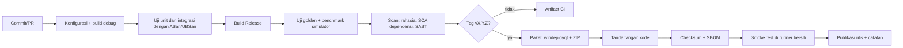

# Deployment & Maintenance Plan: Sabit

Versi dokumen: 0.1 (draf) | Tanggal: 23-10-2026
Rujukan: 02-Technical-Specification.md, 05-Testing-QA-Checklist.md, 09b-Security-Plan.md.

Catatan konteks: Sabit adalah aplikasi desktop offline, bukan layanan server. Istilah "deployment" di sini berarti membangun, menandatangani, mendistribusikan, dan memperbarui aplikasi di laptop lapangan. Tidak ada server produksi, basis data, atau SLA uptime; padanannya adalah **kesiapan lapangan** (aplikasi harus berfungsi pada malam rukyat). Bagian yang tidak berlaku (misalnya migrasi basis data) diterjemahkan ke padanan desktop (migrasi pengaturan dan manifest) dan ditandai.

---

## 1. Ringkasan Infrastruktur



Komponen infrastruktur:

| Komponen | Pilihan | Alasan | Trade-off |
|---|---|---|---|
| Hosting kode | Git (GitHub ASUMSI) | Aksi CI siap pakai | Ketergantungan pada vendor; mirror bisa ditambahkan |
| CI | GitHub Actions, runner `windows-latest` | Cocok untuk MSVC + Qt + vcpkg | Waktu build lama tanpa cache; atasi dengan binary cache vcpkg |
| Penyimpanan artifact | Artifact CI (sementara) + halaman rilis (tetap) | Tanpa biaya server | Retensi artifact terbatas; rilis dipertahankan permanen |
| Distribusi | ZIP portabel + checksum + tanda tangan | Tanpa instalasi dan tanpa Administrator (FR-36) | Pembaruan manual |
| Pembaruan | Manual; pemeriksaan versi dalam aplikasi hanya jika pengguna memintanya | Offline-first, tanpa komunikasi jaringan otomatis (NFR-08) | Pengguna bisa memakai versi lama |
| Telemetri | Tidak ada | Privasi dan offline | Data lapangan harus dikirim manual (paket diagnostik) |

## 2. Manajemen Environment & Konfigurasi

| Environment | Isi | Cara dibuat |
|---|---|---|
| dev | Build debug/sanitizer di mesin developer dan CI | `cmake --preset windows-debug` |
| ci | Build Release + uji otomatis | Workflow `ci.yml` |
| rc | Build Release bertanda tangan untuk uji lapangan (`vX.Y.Z-rcN`) | Tag pra-rilis |
| stable | Rilis publik (`vX.Y.Z`) | Tag rilis |

Konfigurasi aplikasi bukan environment variable, melainkan berkas:

| Berkas | Lokasi | Dikelola oleh | Catatan |
|---|---|---|---|
| `settings.json` | Folder data pengguna (ASUMSI: `%LOCALAPPDATA%\Sabit\`) | Pengguna / aplikasi | Versi skema; backup otomatis sebelum migrasi |
| `profiles/*.json` | Folder yang sama | Pengguna | Profil capture |
| `models/*.onnx` + `models/manifest.json` | Folder aplikasi | Rilis | Hash SHA-256 diverifikasi saat muat |
| `app.log` | `%LOCALAPPDATA%\Sabit\logs\` | Aplikasi | Bergulir |

Variabel build (CI):

| Nama | Wajib | Deskripsi |
|---|---|---|
| `VCPKG_BINARY_SOURCES` | Tidak | Cache biner vcpkg |
| `SIGNING_CERT_BASE64` (rahasia) | Hanya rilis | Sertifikat tanda tangan, disimpan sebagai rahasia CI |
| `SIGNING_CERT_PASSWORD` (rahasia) | Hanya rilis | Kata sandi sertifikat |
| `TIMESTAMP_URL` | Hanya rilis | Layanan cap waktu penandatanganan |

Aturan: tidak ada rahasia di repositori, di binari, atau di log CI. Rahasia hanya tersedia untuk job rilis pada tag, tidak untuk PR dari fork.

## 3. Pipeline CI/CD



Contoh konfigurasi (kerangka; ganti nilai `<...>`; pin aksi ke commit SHA yang sudah diperiksa):

```yaml
# .github/workflows/ci.yml
name: ci
on:
  pull_request:
  push:
    branches: [main]
    tags: ['v*']

permissions:
  contents: read

jobs:
  build-test:
    runs-on: windows-latest
    steps:
      - uses: actions/checkout@<sha>
        with: { submodules: false }

      - uses: ilammy/msvc-dev-cmd@<sha>

      - uses: jurplel/install-qt-action@<sha>
        with:
          version: '<versi Qt 6 LTS>'
          arch: 'win64_msvc2022_64'   # ASUMSI: sesuaikan dengan toolchain yang dipakai

      - uses: lukka/run-vcpkg@<sha>
        with:
          vcpkgGitCommitId: '<commit vcpkg baseline>'

      - name: Configure
        run: cmake --preset windows-release

      - name: Build
        run: cmake --build --preset windows-release

      - name: Test
        run: ctest --preset windows-release --output-on-failure

      - name: Benchmark (simulator)
        run: build\windows-release\Sabit.exe --simulator --perf --duration 30

      - name: Scan rahasia
        uses: gitleaks/gitleaks-action@<sha>

  release:
    if: startsWith(github.ref, 'refs/tags/v')
    needs: build-test
    runs-on: windows-latest
    permissions:
      contents: write
    steps:
      - uses: actions/checkout@<sha>
      # ... konfigurasi dan build seperti di atas ...
      - name: Package
        shell: pwsh
        run: |
          cmake --install build\windows-release --prefix dist\Sabit
          windeployqt --release dist\Sabit\Sabit.exe
          Compress-Archive -Path dist\Sabit\* -DestinationPath "Sabit-${{ github.ref_name }}-win64.zip"
      - name: Sign
        shell: pwsh
        env:
          CERT_B64: ${{ secrets.SIGNING_CERT_BASE64 }}
          CERT_PWD: ${{ secrets.SIGNING_CERT_PASSWORD }}
        run: |
          [IO.File]::WriteAllBytes("cert.pfx", [Convert]::FromBase64String($env:CERT_B64))
          signtool sign /fd SHA256 /tr "<TIMESTAMP_URL>" /td SHA256 /f cert.pfx /p $env:CERT_PWD dist\Sabit\Sabit.exe
          Remove-Item cert.pfx
      - name: Checksum
        shell: pwsh
        run: Get-FileHash -Algorithm SHA256 Sabit-*.zip | ForEach-Object { "$($_.Hash.ToLower())  $(Split-Path $_.Path -Leaf)" } | Out-File SHA256SUMS.txt -Encoding ascii
      - uses: softprops/action-gh-release@<sha>
        with:
          files: |
            Sabit-*.zip
            SHA256SUMS.txt
```

Catatan: langkah Sign harus dijalankan **sebelum** `Compress-Archive` agar yang masuk ZIP adalah binari bertanda tangan; urutan di atas hanya kerangka dan harus diurutkan ulang saat implementasi (ZIP dibuat setelah tanda tangan). Menyimpan sertifikat sebagai rahasia CI adalah trade-off dibanding token perangkat keras (HSM/USB); jika sertifikat dikeluarkan dengan syarat penyimpanan di perangkat keras, gunakan layanan penandatanganan yang sesuai. SBOM: ASUMSI vcpkg dapat menghasilkan SPDX; verifikasi pada versi yang dipakai atau gunakan alat SBOM lain.

## 4. Strategi Deployment

Strategi: **bertahap berdasarkan cincin (ring)**, padanan canary untuk aplikasi desktop.

| Cincin | Penerima | Build | Syarat naik cincin |
|---|---|---|---|
| R0 | Developer | Artifact CI | Semua uji CI lulus |
| R1 | Laptop referensi dan tester internal | `vX.Y.Z-rcN` | Regresi bagian 7 QA lulus |
| R2 | Tim lapangan pada uji (FT) | RC yang sama | Sesi FT tanpa crash; temuan S1 nol |
| R3 | Semua pengguna | `vX.Y.Z` stabil | Exit criteria QA terpenuhi |

Alasan: kesempatan rukyat langka dan tidak bisa diulang, sehingga build tidak boleh pertama kali dicoba pada malam penting. Rolling/blue-green tidak relevan (tidak ada server). Trade-off: lebih lambat dibanding rilis langsung, tetapi mengurangi risiko di lapangan.

**Aturan beku rilis:** tidak ada rilis stabil baru atau pembaruan ke laptop lapangan dalam 7 hari sebelum malam rukyat. Satu-satunya pengecualian adalah perbaikan S1 yang sudah melewati regresi penuh dan disetujui pemilik produk. Kalender beku disusun dari jadwal ijtima/rukyat (lihat 04-Timeline untuk 23-11-2026).

## 5. Checklist Pra-Deploy

- [ ] Semua uji CI hijau pada commit yang akan dirilis (unit, integrasi, golden, benchmark simulator)
- [ ] Regresi manual QA (bagian 7, nomor 12 sampai 16) lulus pada laptop referensi
- [ ] Tidak ada bug S1/S2 terbuka
- [ ] Nomor versi dan `CHANGELOG.md` diperbarui; catatan rilis ditulis (termasuk perubahan skema dan cara rollback)
- [ ] Dependensi diperiksa: tidak ada kerentanan kritis yang diketahui pada Qt, OpenCV, ONNX Runtime, CFITSIO
- [ ] Lisensi pihak ketiga dan notice (Qt LGPL, dll.) disertakan
- [ ] Hash model di `models/manifest.json` cocok dengan berkas
- [ ] DLL SDK vendor sesuai versi yang diuji dan lisensi redistribusi diverifikasi
- [ ] Tidak ada DLL sistem yang ikut terbundel
- [ ] Tidak berada pada jendela beku rilis (7 hari sebelum malam rukyat)
- [ ] Sertifikat tanda tangan masih berlaku (cek tanggal kedaluwarsa)

## 6. Langkah Deploy Step-by-Step

Semua perintah dijalankan di PowerShell. Placeholder ditandai `<...>`. Langkah 1 sampai 6 dilakukan otomatis oleh CI; ditulis di sini agar dapat diulang manual bila CI tidak tersedia.

1. Ambil kode pada tag rilis.

   ```powershell
   git clone https://github.com/<org>/sabit.git
   cd sabit
   git checkout v<X.Y.Z>
   ```

2. Konfigurasi, build, dan uji.

   ```powershell
   cmake --preset windows-release
   cmake --build --preset windows-release
   ctest --preset windows-release --output-on-failure
   ```

3. Pasang ke folder distribusi dan kumpulkan DLL Qt.

   ```powershell
   cmake --install build\windows-release --prefix dist\Sabit
   windeployqt --release dist\Sabit\Sabit.exe
   ```

4. Salin DLL SDK vendor dan model, lalu periksa hash model.

   ```powershell
   Copy-Item <path-sdk-zwo>\*.dll dist\Sabit\
   Copy-Item models\* dist\Sabit\models\ -Recurse
   Get-FileHash -Algorithm SHA256 dist\Sabit\models\*.onnx
   ```

5. Tanda tangan binari (gunakan sertifikat yang aman; jangan menaruh kata sandi di riwayat perintah).

   ```powershell
   signtool sign /fd SHA256 /tr "<TIMESTAMP_URL>" /td SHA256 /f <path-sertifikat.pfx> /p <kata-sandi> dist\Sabit\Sabit.exe
   signtool verify /pa dist\Sabit\Sabit.exe
   ```

6. Buat ZIP dan checksum.

   ```powershell
   Compress-Archive -Path dist\Sabit\* -DestinationPath Sabit-<X.Y.Z>-win64.zip
   Get-FileHash -Algorithm SHA256 Sabit-<X.Y.Z>-win64.zip
   ```

7. Jalankan smoke test di VM bersih (lihat bagian 7).
8. Publikasikan: unggah ZIP, `SHA256SUMS.txt`, dan catatan rilis ke halaman rilis. Tandai sebagai pra-rilis untuk RC.
9. Distribusi ke laptop lapangan: unduh, verifikasi checksum, lalu ekstrak.

   ```powershell
   (Get-FileHash -Algorithm SHA256 .\Sabit-<X.Y.Z>-win64.zip).Hash.ToLower()
   # bandingkan dengan isi SHA256SUMS.txt
   Expand-Archive .\Sabit-<X.Y.Z>-win64.zip -DestinationPath D:\Sabit\<X.Y.Z>
   ```

   Versi lama dibiarkan di folder lama sebagai cadangan rollback.

## 7. Checklist Pasca-Deploy & Smoke Test

Dijalankan pada laptop target setelah ekstraksi (≤ 15 menit). Sama dengan bagian 10 di 05-Testing-QA-Checklist.md; ringkas:

- [ ] Checksum dan tanda tangan valid
- [ ] Aplikasi start ≤ 5 detik dengan akun standar
- [ ] Simulator menampilkan gambar; ubah exposure/gain berfungsi
- [ ] Kamera ZWO terdeteksi dan nilai terbaca balik (bila kamera tersedia)
- [ ] Quick capture menghasilkan FITS yang valid
- [ ] AI menampilkan overlay pada simulator
- [ ] Efemeris menampilkan nilai untuk lokasi aktif
- [ ] `app.log` tanpa error
- [ ] Versi di menu Tentang sesuai rilis

## 8. Rencana Rollback

**Pemicu:**
- Crash berulang (≥ 2 kali dalam satu sesi) pada versi baru.
- Kehilangan data atau frame hilang yang tidak dilaporkan.
- Kontrol kamera tidak berfungsi pada perangkat yang sebelumnya berfungsi.
- Bug S1 yang tidak bisa diperbaiki sebelum jendela pengamatan.

**Langkah (target ≤ 10 menit):**
1. Tutup Sabit.
2. Jalankan versi sebelumnya dari folder lama (`D:\Sabit\<versi-lama>\Sabit.exe`).
3. Jika versi baru menaikkan skema pengaturan, kembalikan cadangan: salin `settings.json.bak-<tanggal>` menjadi `settings.json`.
4. Jalankan smoke test singkat (simulator + kamera).
5. Catat penyebab di pelacak masalah dan tandai rilis bermasalah (catatan di halaman rilis; jangan hapus rilis agar riwayat tetap ada).

**Kompatibilitas mundur:**
- Perubahan skema `settings.json` dan `session.json` bersifat aditif dalam versi minor; versi lama mengabaikan key yang tidak dikenal dan mempertahankannya saat menyimpan.
- Kenaikan skema mayor memerlukan catatan rilis dan cadangan otomatis; versi lama menolak berkas skema yang lebih baru dengan pesan jelas, tanpa menimpa.

## 9. Database Migration Plan (padanan desktop)

Tidak ada basis data. Padanannya adalah migrasi berkas pengaturan dan manifest:

| Langkah | Detail |
|---|---|
| Urutan | 1) deteksi `schema` 2) cadangkan berkas asli ke `.bak-<tanggal>` 3) migrasi bertahap di memori 4) tulis berkas baru secara atomik (tulis sementara lalu rename) |
| Backup | Selalu sebelum menulis ulang; simpan 3 cadangan terakhir |
| Kompatibilitas mundur | Lihat bagian 8 |
| Kegagalan | Berkas yang tidak bisa dimigrasi disimpan sebagai `.corrupt-<tanggal>`; aplikasi memakai default dan memberi tahu pengguna |
| Impor Onyx | Dijalankan manual lewat menu; menghasilkan laporan key yang dibuang |

## 10. Monitoring & Alerting

Karena aplikasi offline dan tanpa telemetri, "monitoring" berarti **pemantauan di dalam aplikasi dan evaluasi pasca-sesi**.

| Metrik | Ambang | Kanal |
|---|---|---|
| Disk kosong | < 2 GB: peringatan; < 500 MB: hentikan rekam aman | Bilah status + dialog |
| Frame hilang | > 0: tampil kuning; > 1% sesi: merah | Bilah status, `session.json` |
| Latensi p95 preview | > 150 ms: peringatan (mode ringan disarankan) | Panel Status |
| FPS inferensi | < 1/detik: peringatan "AI melambat" | Panel Status |
| Suhu sensor | Di luar rentang aman kamera (ditentukan dari capabilities) | Panel Status |
| Jam sistem | Sinkron terakhir > 24 jam | Panel waktu |
| Kamera terputus | Segera | Bilah status merah |

Evaluasi pasca-sesi: tinjau `session.json` counters dan `app.log` setelah setiap sesi; hasil FT dimasukkan ke laporan lapangan. Metrik kesiapan lapangan: persentase sesi tanpa crash dan tanpa frame hilang tak terlaporkan (target 100% pada FT3).

## 11. Logging & Audit

- `app.log`: log aplikasi bergulir (maks 10 berkas x 5 MB); level default info.
- `session.log`: per sesi, di folder sesi; mencatat koneksi, perubahan pengaturan perangkat keras (nilai diminta dan nilai terbaca balik), drop frame, peringatan, deteksi ringkas.
- `session.json`: manifest dengan counters.
- Audit: perubahan pengaturan perangkat keras dan lokasi selama sesi dicatat dengan timestamp UTC; tidak ada akun pengguna.
- Privasi: koordinat lokasi hanya disamarkan pada paket diagnostik bila diminta; log tidak berisi kata sandi atau rahasia (tidak ada yang disimpan).
- Retensi: log aplikasi dibatasi rotasi; berkas sesi dikelola pengguna (disarankan menyimpan permanen sebagai arsip data pengamatan).

## 12. Backup & Disaster Recovery

| Aspek | Target (ASUMSI) | Cara |
|---|---|---|
| RPO data sesi | Maksimal 5 detik data manifest hilang saat crash; data frame yang sudah tertulis aman | Manifest ditulis berkala; berkas frame ditulis atomik |
| RPO arsip | Nol setelah sesi selesai bila disalin | Salin folder sesi ke disk kedua/eksternal segera setelah sesi |
| RTO aplikasi | ≤ 15 menit | Ekstrak ZIP versi stabil terakhir dari USB; kembalikan pengaturan dari cadangan |
| RTO laptop rusak | ≤ 30 menit | Laptop cadangan dengan salinan Sabit yang sudah diverifikasi |

Jadwal dan prosedur:
- **Setelah setiap sesi:** salin folder sesi ke penyimpanan kedua dan hitung checksum.

  ```powershell
  robocopy "D:\Captures\<sesi>" "E:\Arsip\<sesi>" /E /R:2 /W:2
  Get-ChildItem "E:\Arsip\<sesi>" -Recurse -File | Get-FileHash -Algorithm SHA256 | Export-Csv "E:\Arsip\<sesi>\SHA256.csv" -NoTypeInformation
  ```

- **Setiap rilis:** simpan ZIP, `SHA256SUMS.txt`, dan catatan rilis di dua tempat (USB lapangan dan penyimpanan tim).
- **Uji restore:** setiap kuartal dan sebelum musim rukyat (menjelang Ramadan, Syawal, Dzulhijjah), pulihkan Sabit pada laptop bersih dari USB dan jalankan smoke test; catat waktunya terhadap RTO.
- **Kit lapangan (cadangan perangkat):** laptop cadangan, kabel USB 3.0 cadangan, hub berdaya, power bank/UPS, disk eksternal, Onyx OS sebagai cadangan sampai Sabit lolos FT3.

## 13. Rencana Maintenance Rutin

| Frekuensi | Aktivitas | Owner |
|---|---|---|
| Setiap rilis | Pembaruan `CHANGELOG`, SBOM, notice lisensi | Dev B |
| Bulanan | Cek kerentanan dependensi (Qt, OpenCV, ONNX Runtime, CFITSIO, vcpkg baseline) | Dev A |
| Kuartalan | Perbarui patch dependensi, bangun ulang, jalankan regresi penuh | Dev A + Dev B |
| Sebelum tiap musim rukyat (H-21 hari) | Bekukan versi; uji restore; periksa SDK vendor dan driver terbaru; uji ulang pada laptop referensi | Tim |
| Tahunan | Evaluasi model AI pada set uji (drift), perbarui model bila perlu; perbarui tabel golden efemeris | Dev B + penasihat falak |
| Sebelum kedaluwarsa | Perpanjang sertifikat tanda tangan (pengingat 60 hari sebelumnya) | Pemilik produk |
| Saat Windows besar diperbarui | Uji kompatibilitas pada VM dan laptop referensi | Dev A |
| Kapan saja | Putar ulang kunci/akses CI jika ada anggota tim keluar | Pemilik produk |

Pembersihan data: log aplikasi dirotasi otomatis; pengguna diingatkan mengarsipkan dan membersihkan sesi lama (tidak ada penghapusan otomatis data pengamatan).

## 14. Incident Response

| Severity | Definisi | Contoh | Target respons |
|---|---|---|---|
| SEV1 | Gagal pada saat pengamatan penting atau kehilangan data pengamatan | Crash saat rekam pada malam rukyat; FITS rusak | Respons ≤ 30 menit selama jendela pengamatan; mitigasi dengan rollback atau cadangan (Onyx OS/rekam manual) |
| SEV2 | Fungsi penting rusak, ada jalan memutar | Reconnect gagal tapi sambung manual berhasil | Perbaikan ≤ 2 hari kerja |
| SEV3 | Minor | Tampilan tidak benar | Dijadwalkan |

Eskalasi: pelapor -> Dev A/Dev B -> pemilik produk. Pada jendela pengamatan, siapkan satu orang siaga (nomor kontak dibagikan sebelumnya).

Langkah: 1) stabilkan (rollback atau jalur cadangan) 2) kumpulkan paket diagnostik dan `session.log` 3) reproduksi dengan simulator/pemutaran ulang 4) perbaiki dan tambah tes regresi 5) rilis perbaikan melalui cincin R1 ke R3 (dengan pengecualian jendela beku untuk S1) 6) post-mortem dalam 5 hari kerja.

Template post-mortem:

```
Judul insiden:
Tanggal/waktu (UTC dan lokal), durasi:
Severity:
Dampak (data hilang? pengamatan terganggu?):
Kronologi:
Akar masalah:
Apa yang berjalan baik:
Apa yang tidak berjalan baik:
Tindakan korektif (owner, tenggat):
Tes regresi yang ditambahkan:
Perubahan prosedur/dokumen:
```

## 15. Capacity Planning & Estimasi Biaya

**Kapasitas (laptop lapangan):**
- Penyimpanan: 1920x1080 16-bit sekitar 4,1 MB per frame. 20 fps selama 1 jam sekitar 295 GB tanpa kompresi (ASUMSI: sebagian frame disimpan, bukan semua; pengguna memilih durasi dan format). Sediakan SSD ≥ 512 GB dan disk eksternal untuk arsip.
- Memori: ring buffer 512 MB + stacking 2 GB (default) di laptop 8 GB; turunkan untuk laptop lebih kecil.
- Jaringan: tidak dibutuhkan saat operasi.
- Daya: sesi panjang butuh adaptor daya atau power bank/UPS berkapasitas cukup (ukur konsumsi laptop sebenarnya).

**Biaya (perkiraan; verifikasi dengan vendor):**

| Item | Perkiraan |
|---|---|
| CI dan hosting kode | Tingkat gratis mungkin cukup untuk repositori terbuka; untuk repositori privat periksa batas menit CI (ASUMSI) |
| Sertifikat tanda tangan kode | Biaya tahunan sesuai vendor; periksa opsi untuk proyek terbuka (ASUMSI) |
| Penyimpanan rilis | Ukuran ZIP kecil; biaya diabaikan |
| Perangkat keras | Kamera uji, laptop referensi, disk eksternal: di luar anggaran infrastruktur |
| Waktu orang | Pemeliharaan sekitar 2 pd per bulan (ASUMSI) |

## 16. Runbook

| Gejala | Kemungkinan penyebab | Penanganan |
|---|---|---|
| Aplikasi tidak mau start, pesan DLL hilang | ZIP tidak diekstrak penuh, antivirus mengkarantina DLL | Ekstrak ulang, verifikasi checksum, tambahkan pengecualian antivirus pada folder aplikasi |
| Kamera ZWO tidak terdeteksi | Driver belum terpasang, kabel/port bermasalah, aplikasi lain memakai kamera | Pasang driver vendor, ganti kabel/port USB 3.0, tutup aplikasi lain (mis. Onyx OS), klik Rescan |
| Frame hilang saat rekam | Disk lambat, USB jenuh, beban CPU | Pindahkan ke SSD internal, turunkan resolusi/FPS/binning, matikan AI sementara, tutup aplikasi lain |
| Gambar berkedip atau terlalu gelap | Auto stretch pada scene berubah, exposure/gain rendah | Pakai stretch manual; periksa nilai exposure/gain terbaca balik; terapkan profil |
| AI lambat | CPU terbebani | Turunkan `ai_max_fps`, matikan stacking/CLAHE, gunakan mode ringan |
| FITS tidak terbuka di alat lain | Berkas sementara tidak lengkap setelah crash | Hapus berkas dengan akhiran sementara; frame sebelumnya utuh |
| Waktu salah di FITS | Jam sistem tidak sinkron | Sinkronkan jam (`w32tm /resync`) sebelum sesi; periksa panel waktu |
| Laptop tidur saat sesi | Opsi cegah tidur dimatikan atau kebijakan perangkat menimpa | Aktifkan opsi cegah tidur; periksa kebijakan daya; gunakan adaptor daya |
| Layar terlalu terang di lapangan | Tema salah | Pilih Night Red (Ctrl+Shift+N, ASUMSI pintasan) dan redupkan layar |
| Pengaturan hilang setelah pembaruan | Skema berubah | Pulihkan `settings.json.bak-<tanggal>`; laporkan |
| Sinyal kamera hilang tiba-tiba | Kabel longgar, hub tanpa daya | Periksa kabel dan hub berdaya; reconnect otomatis akan mencoba lima kali |

## 17. Open Questions

1. Platform hosting kode dan CI yang dipilih (GitHub, GitLab, lain)? Apakah repositori publik atau privat?
2. Sertifikat tanda tangan kode: siapa penerbit, siapa pemilik, bagaimana disimpan (rahasia CI atau token perangkat keras)?
3. Boleh atau tidak SDK vendor disertakan dalam ZIP (redistribusi)? Jika tidak, bagaimana panduan instalasi driver mandiri?
4. Siapa orang siaga pada jendela pengamatan dan bagaimana kanal komunikasinya?
5. Apakah dibutuhkan kanal pemeriksaan pembaruan (opsional dan manual) di dalam aplikasi?
6. Lokasi data pengguna final: `%LOCALAPPDATA%\Sabit\` atau folder portabel di sebelah `Sabit.exe`?
