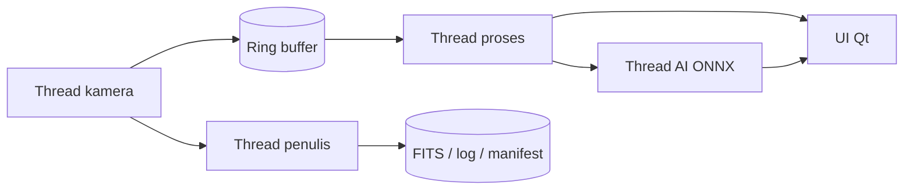

# Sabit


> Status: **pre-alpha, dalam perencanaan.** Kode belum ada; README ini menjelaskan target dan cara membangun yang direncanakan. Bagian bertanda `TODO` akan diisi setelah milestone M1 (walking skeleton, 13-11-2026). Jangan mengikuti perintah build sebelum repositori memuat `CMakePresets.json`.

Sabit adalah aplikasi desktop Windows untuk rukyat hilal: menampilkan live view kamera astronomi, memproses gambar, mendeteksi hilal secara live, dan menyimpan data dengan metadata yang benar.

Sabit adalah rebuild dari Onyx OS (prototipe Python/PyQt6). Nama kerja "Sabit" dapat berubah sebelum rilis.

## Masalah yang diselesaikan

Prototipe sebelumnya menampilkan slider exposure dan gain yang tidak mengatur kamera, mengolah semua di thread UI, membuang data 16-bit, dan tidak melaporkan kegagalan koneksi. Sabit membangun ulang jalur data agar:

- pengaturan kamera benar-benar diterapkan dan dibaca balik,
- live view tidak tersendat saat merekam atau menjalankan AI,
- data tersimpan 16-bit dengan metadata dari perangkat keras,
- setiap kegagalan atau frame yang hilang terlihat oleh pengguna.

## Fitur utama

Target MVP 1.0 (lihat `docs/01-PRD.md`):

- Kamera: ZWO ASI (native), webcam/capture card UVC, simulator.
- Live view dengan stretch, histogram, CLAHE, dan overlay deteksi.
- Kalibrasi dark dan flat; live stacking (mean dan sigma-clip).
- Perekaman FITS 16-bit, TIFF, PNG; folder sesi dengan manifest dan log.
- Deteksi hilal dengan ONNX Runtime; log deteksi CSV.
- Efemeris bulan dan matahari, waktu Maghrib/moonset, kriteria MABIMS (Odeh dan BRIN menyusul sesuai jadwal).
- Tema Dark, Night Red, dan Light; Indonesia dan Inggris.
- Portabel dan offline; tidak butuh hak Administrator (target).

Rencana fase 2: QHYCCD, ASCOM, rekam video, penjelajah sesi.

## Demo / Screenshot

<!-- TODO: tambahkan tangkapan layar setelah M3 -->


## Persyaratan sistem

Pengguna:

- Windows 10 22H2 atau Windows 11, x64.
- Disarankan: Core i5 generasi 8 / Ryzen 5 atau setara, RAM 8 GB, SSD, port USB 3.0.
- Driver kamera dari vendor terpasang (ZWO). TODO: konfirmasi apakah SDK disertakan dalam ZIP.

Pengembang (rencana):

- Visual Studio 2022 dengan toolchain C++ (C++20), CMake, Git.
- vcpkg (manifest mode), Qt 6 (TODO: versi LTS yang dipilih).
- Python 3 untuk alat bantu di `tools/` (hanya mesin pengembang).

## Instalasi

### Pengguna (setelah rilis pertama)

1. Unduh `Sabit-<versi>-win64.zip` dan `SHA256SUMS.txt` dari halaman rilis. TODO: URL halaman rilis.
2. Verifikasi checksum:

   ```powershell
   (Get-FileHash -Algorithm SHA256 .\Sabit-<versi>-win64.zip).Hash.ToLower()
   ```

   Bandingkan dengan isi `SHA256SUMS.txt`.
3. Ekstrak ZIP ke folder pilihan Anda, misalnya `D:\Sabit\<versi>`.
4. Jalankan `Sabit.exe` dengan akun biasa (tanpa Administrator).

### Pengembang (rencana, TODO: verifikasi setelah M1)

```powershell
git clone https://github.com/<org>/sabit.git
cd sabit
cmake --preset windows-release
cmake --build --preset windows-release
ctest --preset windows-release --output-on-failure
```

## Konfigurasi

Konfigurasi aplikasi berbentuk berkas JSON, bukan variabel environment.

| Berkas | Lokasi | Wajib | Default | Deskripsi |
|---|---|---|---|---|
| `settings.json` | `%LOCALAPPDATA%\Sabit\` (TODO: konfirmasi) | Tidak | Dibuat oleh wizard pertama | Bahasa, tema, lokasi, folder simpan, performa, AI |
| `profiles/*.json` | Folder yang sama | Tidak | Hilal Siang, Hilal Senja | Profil capture |
| `models/hilal_v1.onnx` | Folder aplikasi | Ya untuk AI | Disertakan | Model deteksi (hash diverifikasi) |

Contoh `settings.json` (disingkat; lihat `docs/02-Technical-Specification.md`):

```json
{
  "schema": 2,
  "general": { "language": "id", "theme": "night_red", "prevent_sleep": true },
  "site": { "latitude": -6.2088, "longitude": 106.8456, "elevation_m": 10.0,
            "timezone": "Asia/Jakarta", "refraction": true },
  "performance": { "ring_buffer_mb": 512, "stack_ram_mb": 2048, "ai_max_fps": 3 }
}
```

Impor dari Onyx OS: menu Berkas > Impor pengaturan Onyx OS. Key yang tidak dipakai Onyx dilaporkan dan dibuang.

## Cara penggunaan

1. Jalankan `Sabit.exe`; ikuti wizard pertama (bahasa, tema, lokasi, folder simpan).
2. Menu Kamera > pilih kamera > Sambungkan. Tanpa kamera, pilih "Simulator - Hilal senja".
3. Pilih profil capture, atur exposure dan gain. Nilai yang tampil adalah nilai yang dibaca dari kamera.
4. Nyalakan AI (tombol AI di toolbar atau tombol A) bila diperlukan.
5. Klik Mulai sesi, isi nama pengamat dan target, lalu Rekam.
6. Klik Berhenti; ringkasan sesi menampilkan jumlah frame tersimpan dan frame hilang.

Pintasan utama: `Ctrl+K` pilih kamera, `F5` rescan, `Ctrl+Shift+S` quick capture, `Ctrl+R` rekam, `F11` layar penuh, `A` AI, `Ctrl+,` pengaturan.

Opsi baris perintah (rencana):

```powershell
Sabit.exe --simulator                # pakai kamera simulator
Sabit.exe --simulator --perf         # tulis metrik waktu frame ke berkas
```

Hasil sesi tersimpan di folder sesi:

```
Captures/2027-02-07_Jakarta_hilal/
├─ session.json      # manifest
├─ session.log
├─ detections.csv
├─ frames/f_000001.fits ...
└─ calibration/
```

## Struktur proyek

```
sabit/
├─ src/{core,camera,imaging,detect,astro,app,ui}/
├─ vendor/        # header SDK vendor + catatan lisensi
├─ models/        # model ONNX + model card
├─ tests/{unit,integration,golden,perf}/
├─ tools/         # ekspor model, konversi pengaturan Onyx, tabel referensi
├─ docs/          # PRD, spesifikasi teknis, UX, timeline, QA, deployment, security
└─ .github/workflows/
```

## Arsitektur singkat



Detail: `docs/02-Technical-Specification.md`.

## Testing

Rencana (TODO: verifikasi setelah M1):

```powershell
ctest --preset windows-release --output-on-failure
```

Uji unit, integrasi (kamera simulator), dan golden (efemeris terhadap tabel referensi). Rencana lengkap: `docs/05-Testing-QA-Checklist.md`.

## Deployment

Distribusi berupa ZIP portabel bertanda tangan dengan checksum SHA-256. Pembaruan dilakukan manual. Rincian: `docs/06-Deployment-Maintenance-Plan.md`.

## Troubleshooting / FAQ

**Kamera tidak terdeteksi.** Pastikan driver vendor terpasang, gunakan kabel dan port USB 3.0, tutup aplikasi lain yang memakai kamera (termasuk Onyx OS), lalu klik Rescan.

**Frame hilang saat merekam.** Simpan ke SSD internal, turunkan resolusi/FPS/binning, matikan AI sementara.

**Aplikasi tidak mau start dengan pesan DLL hilang.** Ekstrak ulang ZIP secara penuh dan periksa antivirus (karantina DLL).

**Apakah butuh hak Administrator?** Tidak; itu target desain. Bila ada driver yang mensyaratkannya, akan dijelaskan di dokumentasi. TODO: dikonfirmasi setelah uji pada laptop standar.

**Apakah hasil Sabit menetapkan awal bulan?** Tidak. Sabit alat bantu pengamatan dan pencatatan; penetapan resmi oleh otoritas.

## Roadmap

- 09-11-2026: pemakaian lapangan pertama MVP (perkiraan malam rukyat awal Jmadil Akhir 1448 H; penetapan resmi oleh otoritas).
- Maret sampai April 2027: fase 2 (QHYCCD, ASCOM, video, penjelajah sesi).
- Setelahnya: kontrol mount, perbaikan model. Lihat `docs/04-Project-Timeline-Milestones.md`.

## Cara berkontribusi

TODO: finalisasi setelah lisensi ditetapkan. Usulan:

1. Fork dan buat branch dari `main`: `feat/<ringkas>`, `fix/<ringkas>`.
2. Gunakan Conventional Commits: `feat(camera): ...`, `fix(imaging): ...`, `docs: ...`.
3. Jalankan uji dan pemeriksaan format sebelum PR.
4. PR harus menyertakan uji untuk perubahan perilaku dan memperbarui dokumen terkait.
5. Driver kamera baru: ikuti `docs/08-SKILL.md` (kontrak `ICamera`).

## Keamanan

Laporkan kerentanan sesuai [SECURITY.md](SECURITY.md). Jangan membuka isu publik untuk kerentanan.

## Lisensi & kredit

TODO: lisensi proyek belum ditetapkan.

Kredit dan lisensi pihak ketiga (Qt, OpenCV, ONNX Runtime, CFITSIO, pustaka efemeris, SDK kamera vendor) akan dicantumkan di `THIRD_PARTY_NOTICES.md` dan menu Tentang. Sabit berawal dari Onyx OS.
